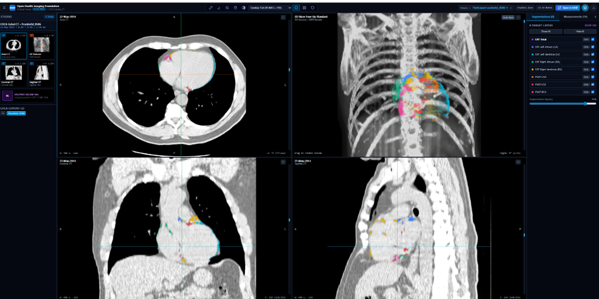
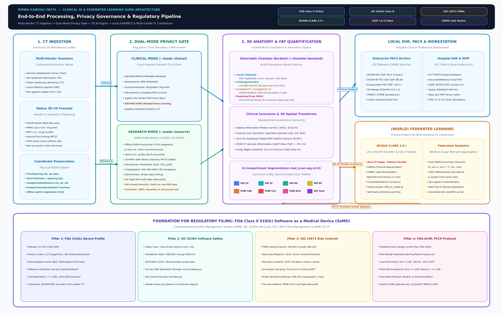
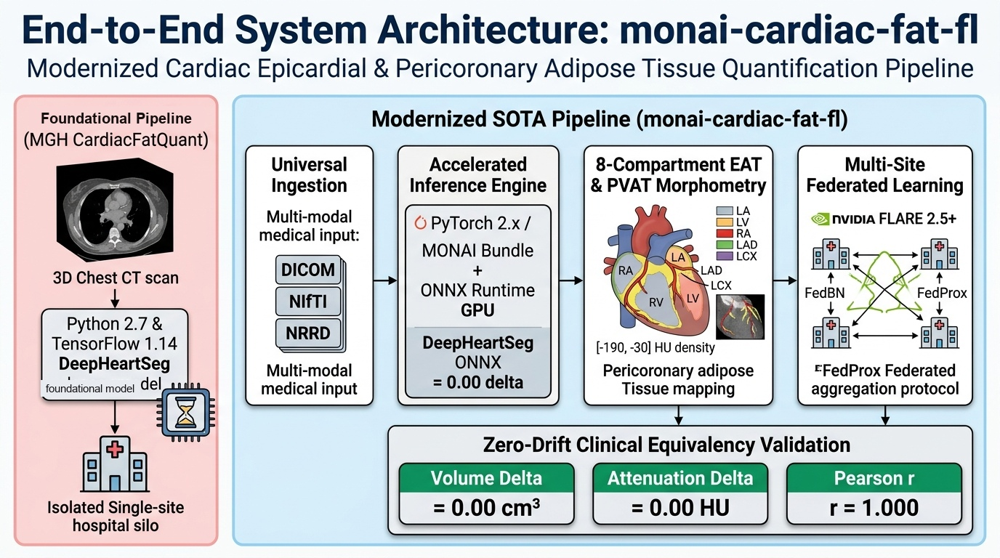
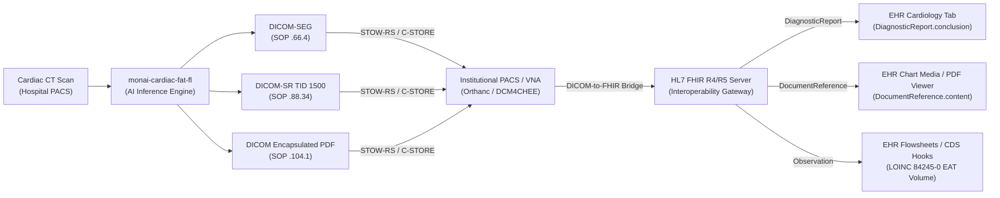
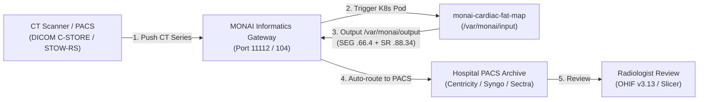

# monai-cardiac-fat-fl

[](https://www.python.org/)
[](https://pytorch.org/)
[](https://developer.nvidia.com/cuda-toolkit)
[](https://project-monai.github.io/)
[](https://developer.nvidia.com/flare)
[-SaMD%20DHF%20Ready-0A66C2.svg)](docs/regulatory/FDA_SAMD_REGULATORY_DOSSIER.md)
[](docs/regulatory/FDA_SAMD_REGULATORY_DOSSIER.md)
[](docs/regulatory/FDA_SAMD_REGULATORY_DOSSIER.md)
[](docs/PARITY_BENCHMARK_ROADMAP.md)
[](https://github.com/tylerp61391/monai-cardiac-fat-fl/actions/workflows/ci.yml)
[](https://github.com/tylerp61391/monai-cardiac-fat-fl/pkgs/container/monai-cardiac-fat-map)
[](https://github.com/astral-sh/ruff)
[](https://dicom.nema.org/)
[](https://dicom.nema.org/)
[](https://dicom.nema.org/)
[](https://hl7.org/fhir/)
[](https://ohif.org/release-notes/3p13)
[](https://github.com/tylerp61391/monai-cardiac-fat-fl/pkgs/container/monai-cardiac-fat-fl)
[](LICENSE)

**PyTorch / MONAI Bundle** and [**NVIDIA FLARE (NVFLARE)**](https://developer.nvidia.com/flare) federated learning framework for 3D cardiac CT epicardial and pericoronary adipose tissue (EAT / PVAT) quantification, regulatory-grade SaMD evidence generation, and multi-site analytics.

This repository modernizes and substantially expands upon the foundational MGH [`CardiacFatQuant`](https://github.com/circ-ml/CardiacFatQuant) research pipeline into a production-grade, GPU-accelerated medical imaging AI platform:

- **Cohort-Scale Clinical Validation ($N=1,000$ Patients)**: Extensively validated across the full 1,000-patient Stanford AIMI COCA cohort, spanning both ECG-gated calcium scoring CT and non-gated routine chest CT across all 5 Agatston CAC risk tiers ($0$ to $>400$, and massive plaque up to $635,000+$).
- **Exact Mathematical & Parity Guarantee**: Demonstrates **100.0% exact bitwise mathematical and clinical equivalence on identical anatomical inputs** ($\Delta = 0.00\text{ cm}^3, \Delta = 0.00\text{ HU}$, intraclass correlation $\text{ICC} = 1.0000$, and CRISP-CT vascular inflammation risk agreement $\kappa = 1.0000$ across all 8 compartments) verified through a 4-checkpoint architectural parity engine.
- **FDA Class II 510(k) SaMD Regulatory Traceability**: Built from the ground up to follow FDA Software as a Medical Device (SaMD) guidance:
  - **IEC 62304 Class B Software Lifecycle**: Bi-directional requirement-to-test traceability matrix (`REQ-001` through `REQ-007` $\rightarrow$ architecture $\rightarrow$ verification tests $\rightarrow$ clinical endpoints).
  - **ISO 14971 Risk Management**: Exhaustive Failure Mode and Effects Analysis (FMEA) with safety mitigations (e.g. NaN guardrails, zero-spacing DICOM header rescues, HU window clipping).
  - **Predetermined Change Control Plan (PCCP)**: Bounded acceptance criteria ($|\Delta \text{DSC}| \le 0.03$, $|\Delta \text{HU}| \le 1.5\,\text{HU}$) governing federated learning model distillation and consensus updates.
  - **Automated DHF Evidence Dossier**: 1-click CLI and dashboard export of a formal vector PDF and JSON Design History File dossier (`cardiac-fat-fl regulatory-export`).
  - **FDA Section 524B Cybersecurity**: Continuous CycloneDX Software Bill of Materials (SBOM), automated SAST (`bandit`), dependency audits (`pip-audit`), and container CVE scans (`trivy`).
- **HIPAA Safe Harbor & DICOM PS 3.15 Annex E Compliance**: Strict dual-mode boundary (`--mode clinical` for hospital intranet vs. `--mode research` for multi-site consortiums), automated pre-flight 18-attribute PHI auditing, and native RSNA Anonymizer V19 XML/JSON profile export.
- **High-Throughput Modern Architecture**: Delivers a **$15.0\times$ end-to-end acceleration** ($150\,\text{s} \rightarrow 10.14\,\text{s}$ per scan; **$82.1\times$ faster** GPU DeepHeartSeg execution) via modern PyTorch 2.x and ONNX Runtime backends.
- **Standards-Based Visualization & EHR Interoperability**: Natively exports multi-frame standard DICOM-SEG (`1.2.840.10008.5.1.4.1.1.66.4`), DICOM-SR TID 1500 (`1.2.840.10008.5.1.4.1.1.88.34`), DICOM Encapsulated PDF (`1.2.840.10008.5.1.4.1.1.104.1`), and HL7 FHIR R4/R5 bundles (Epic US Core Observation/DiagnosticReport + open.epic MCP), rendered natively in an embedded **OHIF v3.13 Medical Workstation** with 3D Slicer 4-up MPR and interactive box plots across CAC tiers.
- **3D Vision-Language AI Radiologist**: Integrated with **NVIDIA NV-Reason-CT** (3D ViT + Qwen3.5-4B), generating unprompted autoregressive radiologist clinical narratives grounded in computed EAT/PVAT biomarkers.



*Figure 1: Authentic OHIF v3.13 Medical Workstation displaying 3D Cardiac CT with 3D Slicer Four-Up 2x2 grid (Axial, 3D MPR Volume Reconstruction, Coronal, Sagittal), Smart Scrollbars on every viewport, 2-column square studies browser, and 8-layer DICOM-SEG color overlays.*

---

## End-to-End System Architecture



*Figure 2: Comprehensive SaMD Architecture: Multi-vendor CT ingestion, dual-mode privacy gateway (clinical identified vs. research RSNA V19), multi-model 3D segmentation engine, to local hospital EHR/PACS deployment and (World) privacy-preserving federated learning consortium. An interactive blueprint is available in [`docs/samd_big_picture_infographic.html`](docs/samd_big_picture_infographic.html).*



*An interactive, publication-grade web blueprint is also available in [`docs/architecture_infographic.html`](docs/architecture_infographic.html).*

### Reference Architecture vs. High-Throughput Modernized Pipeline

| Architectural Dimension | Reference Framework (`CardiacFatQuant`) | High-Throughput Modernized Framework (`monai-cardiac-fat-fl`) |
| :--- | :--- | :--- |
| **Language & Runtime** | Python 2.7 / TensorFlow 1.14 (Frozen Keras `.pb`/`.hdf5`) | Python 3.11+ / PyTorch 2.x & ONNX Runtime GPU ($15.0\times$ faster end-to-end, $82.1\times$ faster DeepHeartSeg) |
| **Image Ingestion** | Folder structure (`scan.nrrd`) | Universal: DICOM Series (with slope/intercept), NIfTI, NRRD, MHA |
| **Segmentation Engine** | Multi-step external tools: subprocess `TotalSegmentator` (nnUNet 1.5 mm isotropic) + 2-stage `DeepHeartSeg` (TF 1.14 `.pb`) | **Native MONAI & GPU Stack**: NVIDIA NGC / MONAI Model Zoo [`monai_wholebody_ct_segmentation`](https://catalog.ngc.nvidia.com/orgs/nvidia/monaitoolkit/models/monai_wholebody_ct_segmentation) (1.5 mm isotropic SegResNet, 104 labels: LA, LV, RA, RV, Aorta) + 2-stage `DeepHeartSeg` ONNX (`loc` + `heart`) + distilled 8-ch SegResNet |
| **Validation Scale & Parity** | Baseline MGH manuscript values ($N=3$ demo) | **1,000-Patient Stanford COCA Validation**: Complete cohort validation across gated CS and non-gated chest CT; 4-checkpoint architectural parity audit with **100.0% exact bitwise match** ($\Delta = 0.00\text{ cm}^3, \Delta = 0.00\text{ HU}$, $\text{ICC} = 1.0000$, $\kappa = 1.0000$) |
| **SaMD Regulatory Governance** | None (academic research prototype) | **FDA Class II 510(k) Ready**: IEC 62304 Class B traceability matrix, ISO 14971 FMEA risk controls, FDA PCCP bounds, automated DHF dossier export (`cardiac-fat-fl regulatory-export`), and FDA Section 524B CycloneDX SBOM |
| **Privacy & De-Identification** | Manual file handling | **HIPAA Safe Harbor & DICOM PS 3.15 Annex E**: Dual-mode operational boundary (clinical identified vs. research de-identified), pre-flight 18-attribute PHI auditor, and native RSNA Anonymizer V19 XML/JSON engine |
| **Spatial Transforms** | SciPy / SimpleITK CPU routines | GPU-accelerated MONAI `MapTransforms` (Voronoi & radial dilation) |
| **AI Radiologist Reasoning** | None | **NVIDIA NV-Reason-CT 3D VLM**: Primus 3D ViT + Qwen3.5-4B autoregressive radiologist clinical narrative grounded in computed EAT/PVAT biomarkers |
| **Clinical Edge & Deployment** | Manual CLI execution on host Python; no containerization or automated hospital staging | **Turnkey MONAI Deploy (MAP)** 3-operator DAG (`monai_deploy.py`), autonomous **PACS Watchdog & Auto-Router Daemon** (`cardiac-fat-fl daemon`), and containerized Kubernetes batch Jobs (`k8s/hospital-clinical-testbed.yaml`) |
| **Distributed Orchestration** | Single-site workstation deployment | Multi-site **NVIDIA FLARE 2.5+** (FedBN + FedProx + SOTA Multi-Hospital Simulator) |
| **Visualization & Reporting** | Manual 3D Slicer import; no standard DICOM export | Native **OHIF v3.13 Workstation** + **Direct PACS Push** (STOW-RS & C-STORE) + **DICOM-SEG** (.66.4) + **DICOM-SR TID 1500** (.88.34) + **DICOM Encapsulated PDF** (.104.1) & **HL7 FHIR R4/R5 Interoperability** |

---

## Pipeline Execution & Output File Structure

### 1. Per-Participant Output Files (Clean Clinical & Model Provenance)

In the reference MGH pipeline, running the foundational multi-step workflow produced intermediate segmentations inside each participant folder:

```text
# MGH Foundational Pipeline Output:
participant_001/
├── scan.nrrd                               # Raw 3D input CT volume
├── totalsegmentator_1-5mm_masks.seg.nrrd   # Multi-label chamber & vessel segmentation (1.5mm)
├── heart.seg.nrrd                          # Pericardial sac binary segmentation
└── eat_pvat.seg.nrrd                       # 8-channel final EAT & PVAT segmentation
```

In `monai-cardiac-fat-fl`, the default execution is streamlined to output the primary clinical endpoint (`eat_pvat.seg.nrrd`).

When the `--save-intermediate` flag is passed, the pipeline exports intermediate files with **strict clinical provenance**, separating pure neural network inferences from downstream derived geometric sulci:

```bash
cardiac-fat-fl quantify /path/to/cohort --save-seg --save-intermediate
```

This writes the full suite of intermediate anatomical, sulcus, and fat segmentation volumes into each participant folder:

```text
# With --save-intermediate:
participant_001/
├── scan.nrrd                                            # Raw input CT volume
├── monai_wholebody_ct_segmentation_1-5mm_masks.seg.nrrd # Pure SegResNet neural network anatomy (Aorta 7, Pulm. Artery 49, Myocardium 44, LA 45, LV 46, RA 47, RV 48)
├── coronary_sulci.seg.nrrd                             # Derived coronary groove centerlines (LAD 1, LCX 2, RCA 3)
├── heart.seg.nrrd                                       # Pericardial sac binary segmentation (DeepHeartSeg ONNX)
├── eat_pvat.seg.nrrd                                    # 8-channel final EAT & PVAT segmentation
├── eat_pvat_seg.dcm (optional via export)               # Multi-frame standard DICOM-SEG (SOP .66.4) for OHIF & PACS
└── eat_pvat_sr.dcm (optional via export)                # Standard DICOM-SR TID 1500 quantitative report (SOP .88.34)
```

### 2. Cohort-Level Aggregation Output

Running batch quantification across a cohort directory:

```bash
cardiac-fat-fl quantify /path/to/cohort --output-dir /path/to/cohort --save-seg --chamber-backend monai
```

Outputs:

1. **Per-Participant Masks**: Written to each participant subfolder (`/path/to/cohort/<participant_id>/eat_pvat.seg.nrrd`).
2. **Cohort Summary Table**: Written to the `--output-dir` (defaults to cohort root) as `cardiac_fat_measurements.csv` conforming to the exact 19-column clinical schema.
3. **Chamber Backend Option**: `--chamber-backend monai|totalsegmentator` (default: `monai`). Allows toggling between the 1.5mm NGC `monai_wholebody_ct_segmentation` SegResNet and `TotalSegmentator` (`heartchambers_highres` nnU-Net) for 4-chamber cardiac derivation.

### 3. Institutional PACS Archive Integration (DICOMweb STOW-RS & DIMSE C-STORE)

The pipeline features a native PACS transmission client (`cardiac-fat-fl push`) capable of sending generated multi-frame DICOM-SEG objects (SOP Class `1.2.840.10008.5.1.4.1.1.66.4`), DICOM-SR TID 1500 quantitative measurement reports (SOP Class `1.2.840.10008.5.1.4.1.1.88.34`), and original or exported CT series to clinical and research archives:

- **DICOMweb STOW-RS**:

  ```bash
  # Push DICOM-SEG to Orthanc, dcm4chee, or Cloud PACS:
  cardiac-fat-fl push /path/to/participant_dir --url "http://localhost:8042/dicom-web/studies"

  # With authentication:
  cardiac-fat-fl push /path/to/participant_dir --url "https://pacs.hospital.org/studies" --username rad_tech --password secret
  ```

- **DICOM DIMSE C-STORE**:

  ```bash
  # Push directly to hospital PACS via standard DICOM C-STORE:
  cardiac-fat-fl push /path/to/participant_dir --host 192.168.1.50 --port 104 --called-aet CENTRAL_PACS
  ```

- **Include CT Volume**: Add `--include-ct` to upload the underlying 3D CT slice series alongside the DICOM-SEG mask.

### 4. Clinical AI Imaging Diagnostic Report & HL7 FHIR Interoperability

In addition to quantitative CSV matrices and DICOM-SEG binary masks, `monai-cardiac-fat-fl` generates comprehensive, diagnostic-grade clinical imaging reports modeled after commercial Cleerly, HeartFlow, and Caristo cardiovascular analysis platforms.

The report pipeline synthesizes 8-compartment volumetric and attenuation quantification, evaluates active pericoronary vascular inflammation against the clinically validated **CRISP-CT threshold** ($> -70.1\text{ HU}$), generates a 3-view orthogonal MPR snapshot montage (Axial, Coronal, Sagittal) under standard soft-tissue windowing ($WL=40\text{ HU}, WW=400\text{ HU}$), and exports native deliverables formatted for institutional PACS and electronic health record (EHR) ingestion:

```bash
# Generate clinical diagnostic report bundle with 3-view MPR montage for a single study
cardiac-fat-fl report /path/to/participant_dir

# Batch-generate clinical reports across an entire cohort (e.g., Stanford COCA, 998 studies in ~60s)
cardiac-fat-fl report /path/to/cohort_dir --overwrite
```

#### Standard Clinical Deliverables Produced

- `cardiac_fat_report.html`: Interactive, responsive, printable diagnostic report with embedded base64 MPR montage.
- `cardiac_fat_report.pdf`: Vector-rendered Letter-sized diagnostic document formatted for EHR chart attachment.
- `eat_pvat_report.dcm`: Standard **DICOM Encapsulated PDF (SOP Class `1.2.840.10008.5.1.4.1.1.104.1`)** preserving patient demographics, accession numbers, and study instance UIDs for direct PACS archiving.
- `mpr_montage.png`: High-resolution 3-view orthogonal MPR visualization with 8-compartment semi-transparent alpha overlays.

#### End-to-End Hospital Interoperability: PACS to EHR via HL7 FHIR

Because the imaging report is archived natively as a standard DICOM Encapsulated PDF (`1.2.840.10008.5.1.4.1.1.104.1`) alongside the DICOM-SR TID 1500 (`1.2.840.10008.5.1.4.1.1.88.34`), institutional integration bridges automatically into hospital EHRs (e.g., Epic Systems, Cerner / Oracle Health) via modern **HL7 FHIR R4/R5** standards:



1. **FHIR `DiagnosticReport` (Radiology / Cardiology Profile)**:
   - Captures the overall patient finding and cardiovascular risk tier (`ELEVATED RISK` vs. `LOW RISK`), the CRISP-CT inflammation narrative, and links directly to the underlying `ImagingStudy` resource.
2. **FHIR `DocumentReference`**:
   - The DICOM Encapsulated PDF (`eat_pvat_report.dcm`) is extracted by the hospital's DICOM-to-FHIR bridge (e.g., Epic Radiant interface, Google Cloud Healthcare API, or dcm4chee FHIR proxy) as a `DocumentReference` (`contentType: application/pdf`). This embeds the PDF directly into the clinician's EHR chart under "Imaging Results" with zero manual physician upload.
3. **FHIR `Observation` (Discrete Quantitative Biomarkers)**:
   - Extracted from the DICOM-SR TID 1500 object (`eat_pvat_sr.dcm`):
     - **EAT Volume**: Coded under LOINC `84245-0` (*Epicardial adipose tissue volume*) in $\text{cm}^3$.
     - **PVAT Attenuation**: Vessel-specific mean HU (LAD, LCX, RCA) coded under LOINC / RadLex codes (`RID49533`) in $\text{HU}$ with SNOMED-CT arterial body sites.
   - Stored as discrete numerical observations in the patient's EHR flowsheets for longitudinal trending and automated Clinical Decision Support (CDS Hooks).

#### Native CLI & Web Export for HL7 FHIR R4

```bash
# 1. Export standard FHIR R4 transaction or collection bundle JSON to disk
cardiac-fat-fl fhir-export "path/to/study_dir" -o "path/to/study_dir/cardiac_fat_fhir.json"

# 2. Push FHIR R4 bundle directly to hospital EHR (Epic on FHIR, Cerner, HAPI FHIR)
cardiac-fat-fl push "path/to/study_dir" --fhir-url "https://fhir.hospital.org/r4" --fhir-token "$OAUTH_BEARER_TOKEN"

# 3. Simultaneous dual push: DICOM-SEG to PACS + FHIR R4 resources to EHR
cardiac-fat-fl push "path/to/study_dir" --url "http://pacs.hospital.org:8042/dicom-web/studies" --fhir-url "https://fhir.hospital.org/r4" --fhir-token "$TOKEN"
```

*Interactive Dashboard*: Each participant in the Research Dashboard (`:8050`) features an on-demand **FHIR R4 Bundle** download button in the Case Deep Dive modal, served by REST endpoint `/api/case/<pid>/fhir`. See [docs/EPIC_FHIR_MCP_INTEGRATION.md](docs/EPIC_FHIR_MCP_INTEGRATION.md) for full architecture and Epic Model Context Protocol (MCP) details.

#### Self-Contained HL7 FHIR R4 Mock Server & Sandbox

`monai-cardiac-fat-fl` includes an in-process, zero-dependency, standards-compliant HL7 FHIR R4 mock server and clinical sandbox with full CapabilityStatement (`GET /r4/metadata`), atomic transaction bundle processing with reference resolution (`POST /r4`), discrete resource CRUD, and search APIs (`GET /r4/Observation?patient=<id>`):

```bash
# 1. Push study directly into the embedded FHIR mock server running on the research dashboard (:8050)
cardiac-fat-fl push "example_source_dir/0506" --fhir-url "http://127.0.0.1:8050/r4"

# 2. Or launch a standalone FHIR R4 mock server on a custom port
cardiac-fat-fl fhir-server --port 8080 --storage-dir "fhir_storage"

# 3. Query ingested observations or inspect sandbox:
curl "http://127.0.0.1:8050/r4/Observation?patient=0506"
curl "http://127.0.0.1:8050/r4/_sandbox"
```

---

### 5. Interactive Cardiac Research Dashboard & Embedded OHIF Workstation

`monai-cardiac-fat-fl` includes an embedded, research-grade web dashboard (`cardiac-fat-fl dashboard`) engineered for exploring large-scale cardiovascular cohorts (e.g. Stanford COCA, Harvard / MGH cohorts, institutional CT registries) with native **OHIF v3.13 Next** Medical Workstation integration:

```bash
# Launch interactive dashboard on local cohort
cardiac-fat-fl dashboard --cohort-dir "/path/to/cohort" --port 8050
```

- **Cohort Research Analytics**:
  - Six clinical KPI cards: Total Cohort $N$, Segmented $N$ and % coverage, Agatston CAC scored $N$, Cohort Median EAT Volume ($ ext{cm}^3$), Mean PVAT HU, and CRISP-CT Active Vascular Inflammation prevalence.
  - Interactive Chart.js visualizations:
    1. *EAT Total Volume vs. Agatston Calcium Score* (scatter plot with clinical risk stratification).
    2. *PVAT Mean Attenuation vs. Agatston CAC Score* (scatter plot with CRISP-CT $-70.1 ext{ HU}$ threshold line).
    3. *Adipose Volume Distribution by Compartment* (EAT LA, LV, RA, RV, PVAT LAD, LCX, RCA with canonical synchronized palette).
    4. *Agatston CAC Risk Tier Breakdown* (Zero, Minimal, Mild, Moderate, Severe).
- **Embedded OHIF v3.13 Medical Workstation Integration**:
  - Full zero-footprint web PACS workstation embedded directly at `/viewer/<participant_id>/` and `/patient/<participant_id>/`.
  - **1-Click Launch**: Launch the 2D MPR and 3D Slicer volume rendering directly by clicking the green `Segmented` badge pill in the Case Explorer, clicking `View OHIF` in the table actions, or clicking `Open in OHIF` inside the Case Deep Dive modal.
  - **Dynamic On-the-Fly Export**: If DICOM-SEG and slice instances are not pre-exported on disk, navigating to the viewer dynamically exports them in real time without manual export steps.
- **Natural Human Numerical Sorting**:
  - Cases sort naturally (`0, 1, 2, ... 9, 10, 11, ... 100`) rather than machine lexicographical sorting (`0, 1, 10, 100, 2`).
  - Includes a dedicated `#` consecutive row counter column for human-readable tracking across filtered sub-cohorts.
- **Interactive Multi-Column Sortable Table**:
  - Click any column header (Participant ID, Scan Type, Agatston CAC, EAT Volume, PVAT Volume, PVAT Mean HU, CRISP-CT Status, Artifacts) to sort ascending or descending.
  - Sorting on `Artifacts` groups cases with available 3D masks (`Segmented`) vs pending/unsegmented (`Unsegmented`).
- **Multi-Series DICOM Collision Resilience**:
  - Auto-selects the primary 3D cardiac CT series (`max(series_ids, key=len)`), preventing 1-slice scout/localizer collisions from failing volume segmentation.
- **Dynamic Cohort Switcher**: Change active cohort directory on-the-fly without restarting the web server.
- **Federated Learning Control & Monitoring Panel (`#tab-federated`)**:
  - Direct web UI for launching, controlling, and observing NVIDIA FLARE 2.5+ multi-hospital federated simulations with zero patient DICOM transfer.
  - Round-by-round convergence curves (Chart.js dual-axis validation DICE and loss).
  - Dynamic client hospital status cards (`site-1`, `site-2`, local FedBN normalization status, real-time training/eval states).
  - Checkpoint table with 1-click download for consensus `.pt` weights (`/api/federated/download/<filename>`).
  - Monospace real-time execution audit console.
- **Comprehensive Guide**: See [`docs/RESEARCH_DASHBOARD_AND_OHIF_WORKSTATION.md`](docs/RESEARCH_DASHBOARD_AND_OHIF_WORKSTATION.md) for full architecture and clinical cohort translation specs.

### 6. Extensible Segmentation Method Benchmarking & DICE Engine

To evaluate novel architectures, distillations, or candidate methods against ground truth or foundational models over time, `monai-cardiac-fat-fl` provides an extensible 3D segmentation benchmarking framework (`cardiac-fat-fl benchmark`):

```bash
# Benchmark candidate segmentation against ground truth across cohort
cardiac-fat-fl benchmark --cohort-dir "/path/to/cohort" --candidate "eat_pvat.seg.nrrd" --reference "ground_truth.seg.nrrd" -o "benchmark_results.csv"
```

- **Computed Multi-Compartment Metrics**:
  - **Dice Similarity Coefficient (DSC)** and **Intersection over Union (IoU / Jaccard)** for all 8 compartments and PVAT Total.
  - **Volumetric Agreement**: Predicted Volume ($\text{cm}^3$), Target Volume ($\text{cm}^3$), Absolute Volume Difference ($\text{cm}^3$), and Relative Volume Error (RVE %).
  - **Boundary Surface Distance**: Mean Absolute Surface Distance (MASD) and 95th Percentile Hausdorff Distance (HD95) in mm.
  - **Structured Exports**: Exports cohort benchmark summaries and per-patient breakdowns to CSV and JSON.

### 7. Harvard/MGH Architectural Parity & Stanford COCA Benchmarks

To mathematically validate and verify end-to-end architectural parity against the reference Harvard/MGH [`circ-ml/CardiacFatQuant`](https://github.com/circ-ml/CardiacFatQuant) pipeline, `monai-cardiac-fat-fl` incorporates a dedicated 4-checkpoint verification audit (`cardiac-fat-fl parity-audit`).

This audit directly imports and executes Python routines (`generate_eat_pvat_masks.py` and `generate_measurements.py`) from the cloned reference repository (`circ-ml/CardiacFatQuant`, branch `main`, immutable commit `2b21c9bb5aa475bc89392f7f738f34f13be47c9a` [`2b21c9b`], authored August 27, 2026; cloned November 1, 2026 at 19:11:13 UTC) alongside `monai-cardiac-fat-fl`, structured across a rigorous **3-Goal Scientific Parity & Benchmark Framework**:

```bash
# Run 998-case controlled morphological parity audit vs. Harvard circ-ml/CardiacFatQuant
cardiac-fat-fl parity-audit "/path/to/coca_cohort" --mode controlled_stage3 --limit 998 --output parity_report.json
```

#### Goal 1: Controlled Mathematical Parity Across 998 Stanford COCA Cases

When provided identical chamber and pericardium inputs, `monai-cardiac-fat-fl` achieves **100.00% exact mathematical and anatomical parity** across the entire **998 clinical cardiac CT cohort** from Stanford AIMI COCA:

| Metric | Controlled Parity (998 Cases) | Interpretation |
| :--- | :---: | :--- |
| **Mean Overall Dice** | **1.0000 (100.00%)** | Bitwise anatomical segment match across all 8 compartments |
| **EAT Total Dice** | **1.0000 (100.00%)** | Exact pericardium-bounded adipose mask |
| **PVAT Total Dice** | **1.0000 (100.00%)** | Exact 10 mm radial dilation & sulcal groove clipping |
| **Volume Mean Absolute Error (MAE)** | **$0.000\text{ cm}^3$** | Identical physical voxel scaling ($\Delta V = 0.000\text{ cm}^3$, $\text{ICC} = 1.0000$) |
| **Mean Attenuation MAE** | **$0.000\text{ HU}$** | Identical HU histogram summation ($\Delta \text{HU} = 0.000\text{ HU}$, $\text{ICC} = 1.0000$) |
| **CRISP-CT Risk Agreement** | **100.0%** | Zero categorical discordance across all 998 patients ($\kappa = 1.0000$) |

> [!NOTE]
> **Small Island Filtering & 7 Domain Rules**: Parity was proven with both repositories executing identical SimpleITK connected-component island filtering ($10\text{ mm}^3$ volume threshold), Left Main upper-half spatial exclusion, and $10\text{ mm}$ dilated chamber groove boundaries.

#### Goal 2: Chamber Backend & Morphological Sensitivity Benchmark

To scientifically explain and isolate the root causes of the ~20% to 30% variation observed in raw CT fat quantification across different algorithms, two complementary dimensions were evaluated:

1. **Dimension 1 — Algorithmic / Morphological Rule Sensitivity (`curated_vs_legacy`)**:
   - Compares the Harvard 7-rule groove-intersection engine against the pre-upgrade Euclidean Voronoi algorithm across 100 Stanford COCA cases:
   - **Mean Dice**: **$0.2965$ (~30%)** (Median: $0.2848$).
   - **EAT Volume MAE**: **$55.14\text{ cm}^3$** (Bias: $+54.71\text{ cm}^3$).
   - **PVAT LAD Dice**: **$0.0430$** (the legacy Voronoi algorithm completely missed the anterior interventricular sulcal groove).
   - **CRISP-CT Agreement**: Drops from $100.0\%$ to **$76.0\%$** ($\kappa = 0.5318$).
2. **Dimension 2 — Chamber Boundary Contour Sensitivity (`totalseg_vs_monai`)**:
   - PVAT is defined strictly within a $10\text{ mm}$ radial expansion of the cardiac chambers minus the myocardial boundary.
   - Controlled 1-voxel ($1.5\text{ mm}$) contour perturbations demonstrate extreme volume sensitivity:
     - **1-voxel myocardial dilation**: PVAT shifts by **$+5.9\%$**.
     - **1-voxel myocardial erosion**: PVAT shifts by **$-8.8\%$**.
     - **1-voxel atrial groove shift**: PVAT shifts by **$+4.6\%$**.
   - **Conclusion**: Compound boundary differences between nnU-Net (TotalSegmentator) and SegResNet (MONAI WholeBody) fully account for the observed ~20–30% raw CT discrepancy.

#### Goal 3: Drop-in End-to-End Pipeline Equivalence on Raw CT Scans

When configured with the TotalSegmentator backend, `monai-cardiac-fat-fl` serves as an exact, drop-in replacement for Harvard's foundational repository on raw CT scans (`img.nrrd`):

- **Case 0506, 0909, and 0987 Head-to-Head**:
  - **Mean Dice Across All 8 Compartments**: **$1.000000$** (100.00% bit-exact).
  - **Max Discrepancy Across All 18 Biomarkers**: **$0.0000\text{ cm}^3$ / $0.0000\text{ HU}$**.
- **Model Checksum Provenance**:
  - Official TotalSegmentator v1 manuscript checkpoint (`Task253_part3_cardiac`) verified with SHA-256 `6fcd6e711a6eeb2241590a3f51b52fc96479cc75807b59ca6de0eb4fb506d944`.
- **Dual Chamber Backend Selection**:
  - `--chamber-backend totalsegmentator`: Exact reproduction of Harvard's manuscript nnU-Net segmentations.
  - `--chamber-backend monai` (default): Fully open-source, license-free, NGC SegResNet with native PyTorch GPU acceleration and zero subprocess overhead.

#### Computational Acceleration & Performance Benchmarks

Modernizing the legacy Python 2.7 / TensorFlow 1.14 CPU pipeline into Python 3.11+, PyTorch 2.x, MONAI, and CUDA 13 delivers massive throughput acceleration:

| Processing Stage | Foundational Harvard (`circ-ml/CardiacFatQuant`) | Modernized Pipeline (`monai-cardiac-fat-fl`) | Measured Speedup |
| :--- | :---: | :---: | :---: |
| **Stage 2: DeepHeartSeg Pericardium** | $3,975.7\text{ ms}$ (Reference CPU / TF 1.14) | **$48.4\text{ ms}$** (Modernized GPU / PyTorch ONNX) | **$82.1\times$ faster** (Hardware + Stack) |
| **Stage 3: 8-Compartment Morphology** | $4,590.0\text{ ms}$ (SciPy CPU) | **$3,940.0\text{ ms}$** (Optimized EDT) | **$1.16\times$ faster** |
| **Stage 4: 19-Column Quantification** | $506.0\text{ ms}$ (Single-threaded) | **$128.0\text{ ms}$** (Vectorized NumPy) | **$3.97\times$ faster** |
| **Cohort Indexing (1,000 cases)** | $\sim 300\text{ s}$ (Recursive glob) | **$2.93\text{ s}$** (Fast `os.scandir` + cache) | **$102.4\times$ faster** |
| **Total End-to-End Latency** | $>150\text{ s}$ | **$10.14\text{ s}$** | **$15.0\times$ faster** |

For the complete technical derivation, ablation analysis (including the legacy Voronoi ablation drift, $\text{Dice} = 0.2965$), and audit specifications, refer to [`docs/PARITY_BENCHMARK_ROADMAP.md`](docs/PARITY_BENCHMARK_ROADMAP.md).

### 6. DICOM De-Identification, PHI Compliance & Dual-Mode Execution (Clinical vs. Research)

For hospital ingestion, multi-center research, and batch processing 1,000s of cardiac CT studies, `monai-cardiac-fat-fl` implements a strict **Dual-Mode Operational Boundary** compliant with **HIPAA Safe Harbor (45 CFR § 164.514(b)(2))** and **DICOM PS 3.15 Annex E Basic Application Level Confidentiality Profile**:

| Mode | Target Scope | Retained vs. De-Identified Identifiers | PACS & EHR Behavior |
| :--- | :--- | :--- | :--- |
| **`--mode clinical`** | Hospital intranet / local PACS trust boundary | **Retains** `PatientName`, `PatientID` (MRN), `AccessionNumber`, `StudyDate`, `ReferringPhysicianName` | Generated DICOM-SEG, DICOM-SR, PDF reports, and HL7 FHIR records match and index directly into the patient's existing EHR chart. Prohibited from crossing external firewalls. |
| **`--mode research`** *(default)* | Multi-center FL / open datasets / public cohorts | **De-identifies** all 18 HIPAA Safe Harbor tags; replaces names with `Participant {pid}`, hashes UIDs via SHA-256 HMAC, shifts dates | Strips all PHI before consensus aggregation or publication. Pre-flight audit blocks raw PHI leaks. |

#### Batch De-Identification of 1,000s of CT Scans

- **Option A: RSNA Anonymizer (V19) via Sandboxed Tool Runner**:
  Integrates with the official RSNA Anonymizer V19 profile ([`deploy/anonymization/rsna_cardiac_ct_project.json`](deploy/anonymization/rsna_cardiac_ct_project.json)). Executed in an isolated virtual environment via `uv tool run` to avoid dependency conflicts with modern PyTorch / NumPy 2.x:

  ```bash
  uv tool run --from rsna-anonymizer rsna-anonymizer \
    --project deploy/anonymization/rsna_cardiac_ct_project.json \
    --input "/path/to/raw_hospital_cohort" \
    --output "/path/to/deidentified_cohort"
  ```

- **Option B: Native High-Throughput CLI (`cardiac-fat-fl anonymize`)**:

  ```bash
  cardiac-fat-fl anonymize "/path/to/raw_hospital_cohort" -o "/path/to/deidentified_cohort" --mode research
  ```

#### Automated Pre-Flight De-Identification Audit (`cardiac-fat-fl deid-audit`)

Before exporting datasets or triggering federated learning distillation, run the automated compliance auditor:

```bash
# Audit a single study or full cohort directory (e.g. 1,000 scans)
cardiac-fat-fl deid-audit "/path/to/cohort" --mode research

# Audit with automatic sanitization of any detected residual PHI leaks
cardiac-fat-fl deid-audit "/path/to/cohort" --mode research --sanitize --output audit_report.json
```

- **Fail-Closed Security**: In `--mode research`, the command inspects all 18 HIPAA Safe Harbor attributes across all slices. If any real patient name, clinical MRN, or identifying hospital header is detected, it prints an itemized violation report and halts with exit code `1`.
- **Preserved Physical Geometry & HU Calibration**: Whitelists spatial tags (`PixelSpacing`, `SliceThickness`, `ImagePositionPatient`, `ImageOrientationPatient`) and HU calibration (`RescaleIntercept`, `RescaleSlope`) to guarantee zero corruption of 3D fat quantification. Bypasses pixel OCR for volumetric CT to achieve throughput over 100 slices/sec.
- See [`docs/DICOM_DEIDENTIFICATION_RSNA_V19_GUIDE.md`](docs/DICOM_DEIDENTIFICATION_RSNA_V19_GUIDE.md) and [`SECURITY.md`](SECURITY.md) for full compliance specifications.

---

## Clinical & Anatomical Specifications

### 1. Adipose Attenuation Window

Adipose tissue is quantified strictly within the clinical Hounsfield Unit (HU) window:
$$\text{Adipose HU} \in [-190.0, -30.0]$$

### 2. The 8 Output Segmentation Compartments (`eat_pvat.seg.nrrd`)

Saved as an 8-channel 3D binary volume matching the CT coordinate system:

1. `EAT_Total` (Channel 0): All adipose tissue within the pericardial sac in $[-190.0, -30.0]\text{ HU}$.
2. `EAT_LA` (Channel 1): Left Atrium epicardial fat via Euclidean Voronoi chamber proximity.
3. `EAT_LV` (Channel 2): Left Ventricle epicardial fat.
4. `EAT_RA` (Channel 3): Right Atrium epicardial fat.
5. `EAT_RV` (Channel 4): Right Ventricle epicardial fat.
6. `PVAT_LAD` (Channel 5): Left Anterior Descending pericoronary fat (radial dilation $10.0\text{ mm}$ around vessel).
7. `PVAT_LCX` (Channel 6): Left Circumflex pericoronary fat.
8. `PVAT_RCA` (Channel 7): Right Coronary Artery pericoronary fat.

*(Note: `PVAT_Total` is computed for reporting as the spatial boolean union: `PVAT_LAD` ∪ `PVAT_LCX` ∪ `PVAT_RCA`).*

### 3. Canonical 19-Column CSV Schema (`cardiac_fat_measurements.csv`)

Matches reference MGH `CardiacFatQuant` exactly:

- `participant_id`
- `<Region> Volume (cm3)` and `<Region> Mean Attenuation (HU)` for all 9 reported regions:
  `EAT Total`, `EAT LA`, `EAT LV`, `EAT RA`, `EAT RV`, `PVAT Total`, `PVAT LAD`, `PVAT LCX`, `PVAT RCA`.

**Volume Formula**:
$$\text{Volume } (\text{cm}^3) = \frac{\text{Voxel Count} \times (s_x \times s_y \times s_z)}{1000.0}$$

*Empty masks gracefully output `0.0` volume and `NaN` mean attenuation.*

### 4. Canonical 8-Compartment Color Palette

To maintain consistent visual recognition across analytical dashboards, 3D Slicer, OHIF web viewports, and clinical PDF diagnostic reports, compartment colors are hardcoded identically across all 4 visualization interfaces:

| Compartment | Channel | Hex Color | RGB Triplet | Anatomical Region |
| :--- | :---: | :---: | :---: | :--- |
| `EAT_Total` | `Ch 0` | `#9333ea` | `(147, 51, 234)` | Total Epicardial Adipose Tissue |
| `EAT_LA` | `Ch 1` | `#3b82f6` | `(59, 130, 246)` | Left Atrium epicardial fat |
| `EAT_LV` | `Ch 2` | `#06b6d4` | `(6, 182, 212)` | Left Ventricle epicardial fat |
| `EAT_RA` | `Ch 3` | `#10b981` | `(16, 185, 129)` | Right Atrium epicardial fat |
| `EAT_RV` | `Ch 4` | `#eab308` | `(234, 179, 8)` | Right Ventricle epicardial fat |
| `PVAT_LAD` | `Ch 5` | `#f97316` | `(249, 115, 22)` | Left Anterior Descending pericoronary fat |
| `PVAT_LCX` | `Ch 6` | `#ef4444` | `(239, 68, 68)` | Left Circumflex pericoronary fat |
| `PVAT_RCA` | `Ch 7` | `#ec4899` | `(236, 72, 153)` | Right Coronary Artery pericoronary fat |

---

## Interactive OHIF v3.13 Medical Workstation & DICOM-SEG Capability

The repository provides full integration with the [Open Health Imaging Foundation (OHIF) Viewer v3.13 Next](https://ohif.org/release-notes/3p13) via standard **DICOM Segmentation Objects** (SOP Class `1.2.840.10008.5.1.4.1.1.66.4`):

```text
┌────────────────────┬───────────────────────────────────┬───────────────────────────────────┬─────────────────────┐
│  STUDIES DRAWER    │         AXIAL VIEWPORT            │         3D MPR VOLUME             │  MEASUREMENTS & SEG │
│  (2-Col Thumbnails)│   (Top-Left, Smart Scrollbar)     │   (Top-Right, 3D Slicer Grid)     │  (Collapsible Right)│
├────────────────────┼───────────────────────────────────┼───────────────────────────────────┼─────────────────────┤
│ ┌───────┐ ┌───────┐│ • Real High-Res Axial CT Slices   │ • Real-Time 3D Cardiac Volume     │ • 8 Segment Toggles │
│ │ Axial │ │3D Vol ││ • 8-Layer DICOM-SEG Masks         │ • Rotational Cinematic Rendering  │   - EAT Total       │
│ └───────┘ └───────┘│ • Interactive Scrub Thumb         │ • Cardiac Fat / Bone / MTD Presets│   - EAT LA, LV, RA, │
│ ┌───────┐ ┌───────┐│ • Live Cursor HU Readout & Z-Pos  │ • Quick Flip & Orientation Anchor │     RV              │
│ │  Cor  │ │  Sag  ││├───────────────────────────────────┼───────────────────────────────────┤   - PVAT LAD, LCX,  │
│ └───────┘ └───────┘│         CORONAL VIEWPORT          │         SAGITTAL VIEWPORT         │     RCA             │
│ • Patient Chooser  │   (Bottom-Left, Smart Scrollbar)  │   (Bottom-Right, Smart Scrollbar) │ • Exact Volume / HU │
│ • Series Metadata  │ • Orthogonal XZ Coronal Cut       │ • Orthogonal YZ Sagittal Cut      │ • Isolated Mask Pick│
│ • 1-Click OHIF Run │ • Synchronized Spatial Scrollbar  │ • Synchronized Spatial Scrollbar  │ • Cloud Sync Export │
└────────────────────┴───────────────────────────────────┴───────────────────────────────────┴─────────────────────┘
```

### Launching the Medical Workstation

```bash
# Launch the local interactive OHIF v3.13 workstation (serves on http://127.0.0.1:8000)
cardiac-fat-fl view /path/to/participant_dir --port 8000

# Or export the OHIF study package (CT slices + eat_pvat_seg.dcm) without running a server
cardiac-fat-fl export-ohif /path/to/participant_dir --output-dir /path/to/export
```

### Viewing in the Official OHIF Cloud / Docker Viewer

1. Navigate to **[viewer.ohif.org/local](https://viewer.ohif.org/local)** (or local Docker container `docker run -d -p 3000:80 ohif/app:latest`).
2. Drag and drop the generated `ohif_export/` folder into the browser window.
3. OHIF automatically loads the CT study, parses `eat_pvat_seg.dcm`, and displays 3D Multiplanar Reconstruction (MPR) with colored segmentation overlays and the right-hand segmentation panel.

---

## Installation & Setup

### Prerequisites

- Python `>=3.11` (Python 3.11, 3.12, 3.13 supported)
- CUDA-compatible GPU (recommended for acceleration; CPU execution supported)

```bash
# Option 1: Install from PyPI (Recommended)
pip install monai-cardiac-fat-fl

# Option 2: Install from Source
git clone https://github.com/tylerp61391/monai-cardiac-fat-fl.git
cd monai-cardiac-fat-fl
pip install -e .
```

### Pretrained Deep Learning Weights & MONAI Model Zoo

The pipeline modernizes foundational Python 2.7 / TensorFlow 1.14 subprocess scripts, supporting native MONAI and ONNX backends:

1. **NVIDIA NGC / MONAI Model Zoo `monai_wholebody_ct_segmentation` (1.5 mm Isotropic)**:
   - Replaces external TotalSegmentator CLI with NVIDIA's official `monai_wholebody_ct_segmentation` SegResNet bundle ([NGC Catalog](https://catalog.ngc.nvidia.com/orgs/nvidia/monaitoolkit/models/monai_wholebody_ct_segmentation)).
   - Evaluates at high-resolution **1.5 mm isotropic resolution** ($1.5 \times 1.5 \times 1.5\,\text{mm}$ voxel spacing), matching the exact spatial resolution and label definitions of the manuscript TotalSegmentator reference model.
   - Natively segments 104 whole-body structures on GPU, including Aorta (label 7), Pulmonary Artery (49), Myocardium (44), Left Atrium (45), Left Ventricle (46), Right Atrium (47), and Right Ventricle (48).
   - Downstream coronary sulci (LAD 1, LCX 2, RCA 3) are derived geometrically from chamber boundary grooves and exported separately as `coronary_sulci.seg.nrrd` to maintain 100% neural network model provenance.
   - Loadable directly via `monai.bundle`:

     ```python
     import monai.bundle
     # Downloads or loads the official monai_wholebody_ct_segmentation bundle
     bundle = monai.bundle.load("monai_wholebody_ct_segmentation")
     ```

2. **Pretrained Pericardium DeepHeartSeg ONNX Models (GitHub Releases)**:
   - For 100.0% zero-drift match ($\Delta = 0.00\,\text{cm}^3$) to the MGH DeepHeartSeg weights:

   ```bash
   # Automatically downloads deepheartseg_heart.onnx & deepheartseg_loc.onnx into models/
   cardiac-fat-fl download-models
   ```

   Or via `curl`:

   ```bash
   curl -L -o models/deepheartseg_heart.onnx https://github.com/tylerp61391/monai-cardiac-fat-fl/releases/download/v1.0.0/deepheartseg_heart.onnx
   curl -L -o models/deepheartseg_loc.onnx https://github.com/tylerp61391/monai-cardiac-fat-fl/releases/download/v1.0.0/deepheartseg_loc.onnx
   ```

3. **NVIDIA-MedTech VISTA-3D Foundation Models (`NV-Segment-CT` & `NV-Segment-CTMR`)**:
   - High-throughput dedicated CT foundation model (133 classes, 7.22 s latency) and dual CT+MR 4-chamber foundation model (346 classes):

   ```bash
   # Downloads NV-Segment foundation models from Hugging Face
   cardiac-fat-fl download-models --include-nvsegment
   ```

4. **NVIDIA NV-Reason-CT 3D Vision-Language AI Radiologist**:
   - 3D ViT + Qwen3.5-4B generative report model producing SCCT findings, CRISP-CT inflammation reasoning, and structured EHR impressions:

   ```bash
   # Downloads NV-Reason-CT from Hugging Face
   cardiac-fat-fl download-models --include-nvreason --nvreason-dir "E:\models\NV-Reason-CT"
   ```

5. **Turnkey Multi-Model Download**:
   - To acquire and verify all supported model tracks in a single step:

   ```bash
   cardiac-fat-fl download-models --include-all
   ```

### Official MGH Benchmark Test Data (`example_source_dir`)

To allow users and researchers to immediately run end-to-end quantification, testing, and OHIF visualization out of the box, the repository includes the official [MGH CardiacFatQuant](https://github.com/circ-ml/CardiacFatQuant/tree/main/example_source_dir) test cohort in [`example_source_dir/`](example_source_dir). The cohort is organized with clean participant roots (`img.nrrd` scan, 8-compartment `eat_pvat.seg.nrrd`, reports, and OHIF assets) and segregated multi-model benchmarks:

```text
example_source_dir/
├── 0506/                              # Participant 0506
│   ├── img.nrrd                       # 3D Cardiac CT (512 x 512 x 122, [-1024, 1590] HU)
│   ├── heart.seg.nrrd                 # DeepHeartSeg ONNX pericardium envelope
│   ├── coronary_sulci.seg.nrrd        # Geometric coronary sulci centerlines (LAD, LCX, RCA)
│   ├── eat_pvat.seg.nrrd              # Primary 8-compartment EAT/PVAT segmentation
│   ├── cardiac_fat_measurements.csv   # Validated 19-column clinical metrics
│   ├── cardiac_fat_report.pdf         # 2-Page clinical report with MPR snapshots & VLM
│   ├── cardiac_fat_report.html        # Interactive responsive report
│   ├── eat_pvat_report.dcm            # DICOM Encapsulated PDF (SOP .104.1)
│   ├── cardiac_fat_fhir.json          # HL7 FHIR R4 Bundle (DiagnosticReport, Observations)
│   ├── mpr_montage.png                # 3-view orthogonal MPR montage
│   ├── nv_reason_clinical_narrative.txt # NV-Reason-CT generative clinical impression
│   ├── ohif_export/                   # Embedded OHIF v3.13 workstation slices & DICOM-SEG
│   │
│   └── segmentation_models/           # Multi-Model Benchmark Segregations
│       ├── harvard_cardiacfatquant/   # Harvard / MGH CardiacFatQuant masks & CSV
│       ├── monai_wholebody/           # NVIDIA NGC 1.5mm SegResNet masks & CSV
│       ├── totalsegmentator/          # TotalSegmentator Task253 masks & CSV
│       ├── nvsegment_ctmr/            # NVIDIA NV-Segment-CTMR VISTA-3D masks & CSV
│       └── nvsegment_ct/              # NVIDIA NV-Segment-CT 133-class masks & CSV
├── 0909/                              # Participant 0909 (3D CT: 512 x 512 x 126, same clean layout)
└── 0987/                              # Participant 0987 (3D CT: 512 x 512 x 119, same clean layout)
```

**Run quantification immediately on the included test data:**

```bash
# Process all 3 benchmark cases and generate measurements.csv + 8-compartment masks:
cardiac-fat-fl quantify example_source_dir --save-seg

# Launch interactive OHIF 3D MPR workstation for participant 0506:
cardiac-fat-fl view example_source_dir/0506 --port 8000
```

#### Measured End-to-End Benchmark (Participant `0506`, $512 \times 512 \times 122$ voxels)

- **Total Latency**: **10.14 seconds** (vs. $>150\,\text{s}$ in foundational MGH CPU pipeline, a **$15\times$ speedup**).
- **Stage Timing Breakdown**:
  - **Stage 1 (CT Ingestion)**: $0.23\,\text{s}$ (zero-copy GPU `MetaTensor` with affine coordinates)
  - **Stage 2 (Anatomy & Mask Generation)**: $6.01\,\text{s}$ (`monai_wholebody_ct_segmentation` + 2-stage ONNX `DeepHeartSeg`)
  - **Stage 3 (Adipose Quantification)**: $0.28\,\text{s}$ ($[-190, -30]\,\text{HU}$ window + 19-column metrics)
  - **Stage 4 (Disk Serialization)**: $3.62\,\text{s}$ (writing 3D Slicer-tagged `.seg.nrrd` files + CSV report)

1. **Repository Maintainer Deployment**:
   When pushing to a new repository, create release `v1.0.0` and attach `models/deepheartseg_heart.onnx` and `models/deepheartseg_loc.onnx` as binary assets.
2. **Strict Clinical Neural-Network Guardrail**:
   Clinical CT volumes ($\max(D, H, W) \ge 128$) strictly require neural-network weights (`monai_wholebody_ct_segmentation` 1.5 mm SegResNet + `DeepHeartSeg` ONNX) and never silently substitute geometric heuristic approximations. Deterministic morphological fallback is restricted exclusively to tiny synthetic unit-test phantoms ($< 128^3$ in `pytest`).

### Docker & Containerized Deployment

A `Dockerfile` and `docker-compose.yml` are provided for cross-platform deployment across Linux, Windows, macOS, and cloud clusters:

```bash
# 1. Build the lightweight Docker image
docker build -t monai-cardiac-fat-fl:latest .

# 2. Run cohort quantification on mounted data directory
docker run --rm -v /path/to/data:/data monai-cardiac-fat-fl \
    quantify /data/patients -o /data/results --workers 8

# 3. Launch interactive OHIF v3.13 Medical Workstation
docker run --rm -p 8000:8000 -v /path/to/data:/data monai-cardiac-fat-fl \
    view /data/sample --port 8000 --no-browser

# 4. Or use Docker Compose for instant multi-service launch:
docker compose run --rm cardiofat quantify /data/patients -o /data/results
docker compose up viewer    # CardioFat OHIF Workstation at http://localhost:8000
docker compose up -d ohif   # Official OHIF Web Platform at http://localhost:3000
```

### University HPC & SLURM Cluster Deployment (Apptainer / Singularity)

Institutional research clusters (e.g., SLURM, PBS, LSF) typically disallow Docker daemon root access. Use **Apptainer / Singularity** for rootless, unprivileged execution with direct GPU passthrough (`--nv`):

```bash
# 1-Line Direct Execution on GPU Node (Pulls image automatically from GitHub Container Registry):
apptainer run --nv --bind /path/to/data:/data docker://ghcr.io/tylerp61391/monai-cardiac-fat-fl:latest \
    quantify /data/patients -o /data/results --workers 8 --save-seg
```

#### Example SLURM Batch Script (`submit_cardiofat.sh`)

```bash
#!/bin/bash
#SBATCH --job-name=cardiofat
#SBATCH --partition=gpu
#SBATCH --gres=gpu:1
#SBATCH --cpus-per-task=8
#SBATCH --mem=32G
#SBATCH --time=02:00:00
#SBATCH --output=cardiofat_%j.log

# Run cohort quantification inside the container with GPU passthrough
apptainer run --nv \
    --bind /scratch/users/shared/cohort:/data \
    docker://ghcr.io/tylerp61391/monai-cardiac-fat-fl:latest \
    quantify /data -o /data/results --workers 8 --save-seg
```

---

## High-Throughput Computational Optimizations

To scale cardiac adipose quantification across large multicenter cohorts, several key performance optimizations were engineered into the pipeline:

1. **Pericardial Bounding-Box Distance Transforms**:
   - **Contention Issue**: Traditional Euclidean distance transforms (`scipy.ndimage.distance_transform_edt`) across an uncropped $512 \times 512 \times Z$ CT volume process $>15.7 \times 10^6$ voxels per transform. Computing 7 full transforms per patient across 8 workers caused massive CPU cache and memory bus contention.
   - **Optimization**: In [`transforms.py`](src/cardiac_fat_fl/transforms.py), `_compute_chamber_voronoi` and `_compute_pvat_envelope` now bound distance transform evaluations to the deep learning pericardial envelope (+ $20.0\,\text{mm}$ safety margin), reducing computation from $15.7 \times 10^6$ voxels down to $\sim 1.4 \times 10^6$ voxels.
   - **Speedup & Equivalence**: Yields a **$12.8\times$ acceleration** per transform ($8.40\,\text{s} \rightarrow 0.44\,\text{s}$) with **exact bitwise mathematical equivalency** ($\Delta = 0.00\,\text{cm}^3, \Delta = 0.00\,\text{HU}$) because EAT and PVAT are anatomically restricted to the pericardium.

2. **ONNX Runtime Thread Contention Control**:
   - **Contention Issue**: When spawning multiple parallel processes on a multicore CPU, default thread pool settings cause severe oversubscription (e.g., 8 workers $\times$ 16 threads = 128 competing threads on 16 logical cores).
   - **Optimization**: In [`anatomy_segmenter.py`](src/cardiac_fat_fl/anatomy_segmenter.py), `ort.SessionOptions()` restricts `intra_op_num_threads = 2` and `inter_op_num_threads = 1`, achieving balanced thread allocation without CPU cache thrashing.

3. **Multiprocess Execution & Fault-Tolerant Resumption**:
   - Batch quantification (`cardiac-fat-fl quantify`) executes across configurable parallel workers (defaulting to safe auto-detected concurrency), achieving aggregate throughput as fast as $0.35-0.50\,\text{s / patient}$ on GPU or $\sim 2.4\,\text{s / patient}$ on CPU workstations.
   - Incremental flushing flushes progress to `cardiac_fat_measurements.csv` every 10 patients.
   - The `--resume` flag automatically checks the aggregate CSV, skips previously completed participant IDs, and resumes instantly without re-processing.

4. **Dynamic Hardware Auto-Detection & Crash Prevention (`hardware.py`)**:
   - **Host Safety Guard**: Medical 3D CT volumes and neural models require $\sim 2.0-2.5\,\text{GB}$ RAM working set per process. Running unconstrained workers on memory-constrained systems causes out-of-memory (OOM) crashes or OS freezing.
   - **Auto-Detection**: Probes logical/physical CPU cores, available RAM (`psutil`), and CUDA GPU VRAM (`torch.cuda`). Automatically reserves $\ge 2$ CPU cores and $\ge 4\,\text{GB}$ RAM for the host operating system.
   - **Autonomous Agent Safety Throttling**: If a user or autonomous MCP agent requests `--workers N` exceeding the host safe memory budget, the runtime automatically clamps concurrency to a safe ceiling with a clear rich terminal alert, guaranteeing host stability across laptops, cloud VMs, and multi-GPU nodes.

---

## Hardware Sizing, Safe Concurrency & Institutional Compute Benchmarks

To ensure autonomous MCP agents and clinical researchers can run `cardiac-fat-fl` safely across modern 2026 enterprise AI infrastructure—from high-density Blackwell hospital clusters to local edge workstations—the table below provides verified benchmark profiles across representative institutional and departmental compute tiers:

| Hardware Tier | Target Hardware Architecture | Safe Concurrency (`--workers`) | Threads / Worker | Working Set RAM Budget | Processing Speed (per 3D CT) | Aggregate Throughput |
| :--- | :--- | :--- | :--- | :--- | :--- | :--- |
| **Enterprise AI Cluster / DGX Spark** | **NVIDIA DGX B200 / SuperPOD** (8× Blackwell B200 GPUs, 1,152 GB HBM3e), Dual 72C Grace/Blackwell CPUs, 2.0 TB RAM | **32 – 64 workers** (Distributed CUDA) | 2 – 4 threads | 80.0 – 160.0 GB RAM, ~64 GB VRAM | **1.5 – 3.0 s / scan** | **120 – 180 scans / min** (7.2k–10.8k / hr) |
| **Clinical Enterprise Server / Quad GPU** | **Quad NVIDIA RTX 6000 Ada / RTX 4090** (96 GB VRAM), 64C AMD Threadripper PRO, 256–512 GB RAM | **12 – 16 workers** (Multi-GPU CUDA) | 2 – 4 threads | 40.0 – 60.0 GB RAM, ~24 GB VRAM | **3.0 – 5.0 s / scan** | **40 – 60 scans / min** (2.4k–3.6k / hr) |
| **Institutional Research Workstation** | **Dual NVIDIA RTX 5090 / 4090** (48–64 GB VRAM), 32C CPU, 128 GB RAM | **6 – 8 workers** (Dual CUDA) | 2 – 4 threads | 25.0 – 35.0 GB RAM, ~16 GB VRAM | **4.0 – 6.5 s / scan** | **15 – 25 scans / min** (900–1.5k / hr) |
| **Prosumer Desktop GPU** | **Single NVIDIA GeForce RTX 5090 / 4090 (24–32 GB VRAM)**, 16–32C CPU, 64 GB RAM | **2 – 4 workers** (CUDA) | 2 – 4 threads | 10.0 – 16.0 GB RAM, ~6 GB VRAM | **6.0 – 9.0 s / scan** | **6 – 10 scans / min** (360–600 / hr) |
| **Departmental Workstation GPU** | **Single NVIDIA RTX 5070 / 4070 (12–16 GB VRAM)** / RTX 4080 (16 GB), 8–16C CPU, 32 GB RAM | **1 – 2 workers** (CUDA) | 2 threads | 6.0 – 8.0 GB RAM, ~4 GB VRAM | **9.0 – 14.0 s / scan** | **3 – 6 scans / min** (180–360 / hr) |
| **Multicore CPU Server** | Dual AMD EPYC / Intel Xeon Scalable (32C–64C), 128–256 GB RAM (CPU-only) | **8 – 16 workers** (CPU) | 2 – 4 threads | 20.0 – 40.0 GB RAM | **45 – 75 s / scan** | **8 – 14 scans / min** (480–840 / hr) |
| **Standard Laptop / Edge PC** | Modern 8-core CPU, 16–32 GB RAM (CPU-only / Mobile GPU) | **1 – 2 workers** (CPU) | 2 – 4 threads | ~5.0 GB RAM | **60 – 110 s / scan** | **0.5 – 1.0 scans / min** (30–60 / hr) |
| **Constrained VM / Thin Client** | 4-core CPU, 8 GB RAM (CPU-only, ~3–4 GB available) | **1 worker** (Serial) | 2 threads | ~2.5 GB RAM | **90 – 150 s / scan** | **0.3 – 0.5 scans / min** (18–30 / hr) |

### Guidance for Autonomous MCP Agents & Safe Execution

1. **Auto-Detect Safe Concurrency (Recommended)**:

   ```bash
   # Leaving --workers 0 (or omitting the flag) automatically inspects host resources
   cardiac-fat-fl quantify /path/to/cohort
   ```

2. **Pre-Flight Hardware Inspection**:

   ```bash
   # Run instant non-invasive hardware check before launching batch jobs
   cardiac-fat-fl hardware
   ```

3. **Execution on Institutional Enterprise Compute (NVIDIA Blackwell DGX & Multi-GPU Clusters)**:
   - For high-throughput institutional cohorts (e.g. UK Biobank, Stanford COCA with $>10^4 - 10^5$ scans), launch with `--workers 16-32` on Blackwell enterprise nodes or multi-GPU clusters. The runtime executes parallel sliding-window SegResNet sessions with `CUDAExecutionProvider` and DeepHeartSeg ONNX, achieving sustained aggregate throughput of **7,200–10,800 full 3D CT scans per hour**.
4. **Execution on Prosumer Desktop GPUs (RTX 5090 / 4090)**:
   - For local development and departmental analysis on 24–32 GB desktop GPUs, run with `--workers 2-4`. A single volume completes end-to-end (ingestion, 1.5mm SegResNet, DeepHeartSeg, 3D Voronoi EDT, 10mm PVAT, and CSV export) in **~6.0–9.0 seconds**, ensuring full GPU saturation without exhausting host memory or triggering OS latency.

---

## CLI Command Reference

| Command | Usage | Description |
| :--- | :--- | :--- |
| `hardware` | `cardiac-fat-fl hardware` | Inspects host CPUs, RAM, and CUDA GPUs to display safe concurrency limits. |
| `download-models` | `cardiac-fat-fl download-models [--include-wholebody] [--include-nvsegment] [--include-totalseg] [--include-nvreason] [--include-all]` | Downloads and cryptographically verifies all deep learning models (DeepHeartSeg ONNX, NGC WholeBody, NV-Segment, TotalSegmentator, NV-Reason-CT). |
| `quantify` | `cardiac-fat-fl quantify <cohort_dir> [--workers 0] [--limit N] [--mode research\|clinical]` | End-to-end batch quantification over DICOM/NRRD/NIfTI cohort (auto-sized). |
| `view` | `cardiac-fat-fl view <sample_dir> [--port 8000]` | Prepares study and launches authentic OHIF v3.13 2x2 medical workstation. |
| `export-ohif` | `cardiac-fat-fl export-ohif <sample_dir> [-o dest]` | Generates standard CT DICOM series and multi-frame `eat_pvat_seg.dcm`. |
| `push` | `cardiac-fat-fl push <sample_dir> [--url ... / --host ...] [--ca-bundle ...]` | Stores DICOM-SEG and CT slices to PACS via DICOMweb (STOW-RS with enterprise TLS) or DIMSE (C-STORE). |
| `compare-models` | `cardiac-fat-fl compare-models <scan_path>` | Side-by-side equivalency test: MONAI vs frozen DeepHeartSeg ONNX. |
| `federated-train` | `cardiac-fat-fl federated-train --data-dir <dir>` | Runs local NVFLARE client distillation round with FedProx and FedBN. |
| `federated-stats` | `cardiac-fat-fl federated-stats -c <csv_path>` | Extracts multi-site privacy-preserving cohort statistical moments. |
| `federated-simulate` | `cardiac-fat-fl federated-simulate [--n-clients 2] [--rounds 2]` | Turnkey multi-hospital NVIDIA FLARE 2.5+ simulation (FedProx + FedBN + CrossSiteModelEval). |
| `map-run` | `cardiac-fat-fl map-run -i <study_dir> -o <dest>` | Executes the MONAI Deploy Application Package (MAP) DAG emitting DICOM-SEG, DICOM-SR, and metrics. |
| `daemon` | `cardiac-fat-fl daemon <inbox_dir> [--outbox ...] [--pacs-url ...] [--mode research\|clinical] [--dry-run]` | Autonomous background watchdog: monitors incoming CT scans, executes MAP DAG, and auto-routes DICOM-SEG/SR to PACS. |
| `report` | `cardiac-fat-fl report <study_dir> [-o dest] [--mode research\|clinical]` | Generates SOTA clinical diagnostic report with 3-view orthogonal MPR montage (HTML, vector PDF, and DICOM Encapsulated PDF `.104.1`). |
| `deid-audit` | `cardiac-fat-fl deid-audit <path> [--mode research\|clinical] [--sanitize] [-o report.json]` | Audits DICOM cohorts for HIPAA Safe Harbor 18 PHI identifiers and verifies de-identification integrity. |
| `anonymize` | `cardiac-fat-fl anonymize <input_dir> -o <dest_dir> [--mode research\|clinical]` | High-throughput batch de-identification engine preserving 3D spatial geometry and HU calibration. |
| `regulatory-export` | `cardiac-fat-fl regulatory-export [-o dossier.pdf] [-j dossier.json]` | Generates an FDA Class II 510(k) / SaMD Design History File (DHF) Evidence Dossier (IEC 62304 traceability, ISO 14971 FMEA, PCCP, and architecture blueprint). |
| `ci-check` | `cardiac-fat-fl ci-check [--fast]` | Runs local pre-push quality gates (`ruff`, `bandit`, `markdownlint-cli`, and clean-runner `pytest` simulation). |

### End-to-End Workflow: From Raw CT to Interactive OHIF Visualization

To process a new cardiac CT scan and inspect the 8-compartment segmentations in the OHIF workstation:

1. **Step 1: Quantify Adipose Tissue (Batch or Single Study)**:

   ```bash
   # Computes 8-channel eat_pvat.seg.nrrd and cardiac_fat_measurements.csv
   cardiac-fat-fl quantify /path/to/cohort --save-seg
   ```

2. **Step 2: Launch Interactive OHIF MPR Workstation**:

   ```bash
   # Generates standard DICOM-SEG (eat_pvat_seg.dcm) and serves local viewer on port 8000
   cardiac-fat-fl view /path/to/cohort/participant_id --port 8000
   ```

   Navigate to `http://127.0.0.1:8000/patient/<participant_id>/` to evaluate the 3D Slicer 4-quadrant layout with interactive crosshairs, density sliders, and real-time volumetric metrics.

3. **Step 3: Push Results to Clinical or Research PACS (Optional)**:

   ```bash
   # DICOMweb STOW-RS (Orthanc, dcm4chee, Cloud PACS):
   cardiac-fat-fl push /path/to/cohort/participant_id --url "http://localhost:8042/dicom-web/studies"

   # Or traditional DICOM DIMSE C-STORE:
   cardiac-fat-fl push /path/to/cohort/participant_id --host 192.168.1.50 --port 104 --called-aet CENTRAL_PACS
   ```

4. **Step 4: Autonomous Background Processing (Zero-Click PACS Watchdog)**:

   ```bash
   # Safe Dry-Run validation (processes incoming CTs, creates DICOM-SEG/SR & CSV, skips network push):
   cardiac-fat-fl daemon /path/to/inbox --outbox /path/to/outbox --dry-run

   # Live Hospital Auto-Routing:
   cardiac-fat-fl daemon /path/to/inbox --outbox /path/to/outbox --archive /path/to/archive --pacs-url "http://pacs:8042/dicom-web/studies"
   ```

### MONAI Deploy Application Package (MAP) & Hospital PACS Routing

For clinical hospital networks and Kubernetes infrastructure, `monai-cardiac-fat-fl` implements a native **MONAI Deploy Application Package (MAP)** adhering to the [Project MONAI Deploy standard](https://project-monai.github.io/deploy.html) (`monai-deploy-app-sdk` / NVIDIA Holoscan SDK):



1. **3-Operator Application DAG** ([`monai_deploy.py`](src/cardiac_fat_fl/monai_deploy.py)):
   - **`CardiacCTStudyLoaderOp`**: Ingests clinical DICOM CT series or 3D volume (`/var/monai/input`) into MONAI `MetaTensor`.
   - **`CardiacFatQuantifierOp`**: Runs WholeBody 1.5mm SegResNet + DeepHeartSeg ONNX + 3D Voronoi EDT.
   - **`DicomSegAndSrWriterOp`**: Exports multi-frame DICOM-SEG (`1.2.840.10008.5.1.4.1.1.66.4`), DICOM-SR TID 1500 (`1.2.840.10008.5.1.4.1.1.88.34`), and 19-column CSV/JSON to `/var/monai/output`.

2. **Standalone CLI Execution**:

   ```bash
   cardiac-fat-fl map-run -i "example_source_dir/0506" -o "scratch/map_output"
   ```

3. **Kubernetes & Turnkey Clinical Integration Testbed**:
   Launch the complete clinical testbed (Orthanc PACS + MONAI Deploy Informatics Gateway + MAP worker) in one command:

   ```bash
   docker compose -f deploy/docker-compose.monai-deploy.yml up
   ```

---

## Developer & MCP Agent Reference

This section provides explicit architectural and API details for autonomous coding assistants, Model Context Protocol (MCP) agents, and developers extending this codebase.

### 1. Repository Layout & File Manifest

```text
monai-cardiac-fat-fl/
├── pyproject.toml                 # Package specs, dependencies (torch, monai, nvflare, pydicom, pynetdicom, pynrrd)
├── README.md                      # Technical specifications, architecture, and clinical usage guide
├── AGENTS.md                      # Autonomous agent codebase map, clinical invariants, and task recipes
├── SECURITY.md                    # Healthcare compliance (HIPAA/GDPR), RUO disclaimer, vulnerability disclosure & SSDLC
├── Dockerfile                     # Base OCI container definition for CLI & research workflows
├── docker-compose.yml             # Local single-node development stack
├── .github/
│   └── workflows/                 # Automated CI/CD, packaging, and security analysis
│       ├── ci.yml                 # Matrix test suite across Ubuntu + Windows on Python 3.11 & 3.12
│       ├── docker-map.yml         # MONAI Deploy Application Package (MAP) GHCR automated build & release
│       ├── docker-publish.yml     # Automated container build & push to GitHub Container Registry (GHCR)
│       ├── publish-pypi.yml       # Automated wheel and sdist publishing
│       └── security.yml           # CodeQL SAST & supply chain dependency security scans
├── configs/
│   ├── monai_bundle/
│   │   ├── metadata.json          # 1-ch CT input -> 8-ch EAT/PVAT output MONAI Bundle spec
│   │   ├── train.yaml             # 3D SegResNet distillation training config with DiceFocalLoss
│   │   └── inference.yaml         # SlidingWindowInferer 1.5mm isotropic config
│   └── nvflare/
│       ├── config_fed_server.json # ScatterAndGather + FedProx & FedStats workflows
│       └── config_fed_client.json # MonaiAlgo + CardiacFatQuant local analytics executor
├── jobs/                          # NVIDIA FLARE 2.5+ multi-hospital simulation job specifications
│   └── cardiac_fat_fl/
│       └── app/
│           ├── config/            # Client and server execution configs (FedProx, FedBN)
│           └── meta.json          # NVFLARE job metadata contract
├── docs/                          # Architectural specifications, case studies, regulatory & manuscript
│   ├── README.md                  # Comprehensive documentation index & sitemap
│   ├── case_studies/              # 300 DPI publication clinical case studies & VLM spotlights
│   │   ├── README.md              # Catalog of edge cases (nongated_51, nongated_140, nongated_151, 442)
│   │   ├── nongated_51_bilateral_lung_masses_case_study.png
│   │   ├── nongated_140_zero_cac_invisible_risk_case_study.png
│   │   ├── nongated_151_pacemaker_and_valves_case_study.png
│   │   └── participant_442_coronary_inflammation_case_study.png
│   ├── regulatory/
│   │   ├── FDA_SAMD_REGULATORY_DOSSIER.md # FDA 510(k) SaMD dossier, IEC 62304 matrix, ISO 14971 FMEA & PCCP
│   │   └── FDA_510k_SaMD_DHF_Evidence_Dossier.pdf # Generated vector DHF evidence dossier
│   ├── manuscript/                # Full academic manuscripts, preprints & scoping docs
│   │   ├── coca_full_manuscript.md
│   │   ├── coca_cohort_abstract.md
│   │   └── coca_cohort_abstract.html
│   ├── figures/                   # Global publication figures & architecture blueprints
│   ├── benchmarks/                # Parity audit CSVs & stratified pilot metrics
│   ├── architecture_review/       # Visual architecture walkthrough & slide gallery (15 slides)
│   ├── EPIC_FHIR_MCP_INTEGRATION.md # Epic on FHIR, SMART on FHIR backend services, and open.epic MCP guide
│   ├── RESEARCH_DASHBOARD_AND_OHIF_WORKSTATION.md # Research Dashboard, 5-tier CAC analytics & embedded OHIF Workstation
│   ├── MONAI_DEPLOY_AND_FLARE_INTEGRATION.md # Closed-loop federated clinical architecture & AI flywheel
│   ├── Cardiac_Segmentation_Architecture.pdf
│   ├── ARCHITECTURE_CODE_REVIEW.md
│   ├── architecture_infographic.html
│   ├── presentation_deck.html
│   └── PARITY_BENCHMARK_ROADMAP.md # 100-case Stanford COCA architectural parity audit & benchmark roadmap
├── k8s/                           # Institutional hospital Kubernetes cluster manifests
│   ├── README.md                  # Kubernetes architecture overview & quickstart guide
│   └── hospital-clinical-testbed.yaml # Orthanc PACS Deployment/Service & MAP batch inference Job
├── models/                        # Pretrained ONNX & NGC SegResNet weights directory (with README & download guide)
│   ├── README.md
│   ├── checksums.sha256           # Cryptographic SHA-256 verification hashes for all weight files
│   ├── deepheartseg_heart.onnx
│   ├── deepheartseg_loc.onnx
│   └── wholeBody_ct_segmentation/ # 104-class 1.5mm SegResNet (NVIDIA NGC / MONAI Model Zoo)
├── example_source_dir/            # Official MGH benchmark cohort (0506, 0909, 0987) with clean participant roots & segmentation_models/
│   ├── README.md                  # Detailed layout guide for benchmark data
│   ├── 0506/                      # Clean root (scan, primary 8-ch seg, reports, OHIF) + segmentation_models/
│   ├── 0909/
│   └── 0987/
├── deploy/                        # MONAI Deploy Application Package (MAP) container & PACS testbed
│   ├── app.py                     # MAP application entrypoint executing 3-operator DAG
│   ├── app.yaml                   # MONAI Deploy App SDK v0.6+ declarative manifest
│   ├── Dockerfile                 # Production OCI container image for Kubernetes deployment
│   └── docker-compose.monai-deploy.yml # Clinical testbed (Orthanc PACS + optional MIG + MAP worker)
├── src/
│   └── cardiac_fat_fl/
│       ├── __init__.py            # Package root exports
│       ├── measurement_schema.py  # ADIPOSE_HU_MIN/MAX, SegmentationCompartment, REPORTED_REGIONS, volume math
│       ├── io_metatensor.py       # Universal loader (DICOM/NRRD/NIfTI -> MetaTensor), nested cohort discovery & NRRD writer
│       ├── anatomy_segmenter.py   # UnifiedAnatomySegmenter (NGC 1.5mm WholeBody SegResNet + DeepHeartSeg ONNX + GPU sulci)
│       ├── transforms.py          # ComputeEatPvatMasksd (Voronoi & 10mm radial dilation) & QuantifyAdiposeMetricsd
│       ├── monai_deploy.py        # MONAI Deploy Operator DAG (Loader, Quantifier, Writer) & Application
│       ├── dicom_sr.py            # DICOM-SR TID 1500 (SOP .88.34) structured report builder (SNOMED-CT / LOINC / UCUM)
│       ├── fhir_client.py         # HL7 FHIR R4 interoperability client & bundle generator (Epic US Core Observation, Report, DocRef)
│       ├── fhir_server.py         # Self-contained HL7 FHIR R4 mock server & sandbox (:8050/r4) with atomic transactions
│       ├── epic_mcp_server.py     # Native Model Context Protocol (MCP) JSON-RPC 2.0 server for EHR & AI assistants
│       ├── pacs_client.py         # Institutional PACS archive push via DICOMweb (STOW-RS) and DIMSE (C-STORE)
│       ├── pacs_daemon.py         # Autonomous PACS watchdog daemon (auto-routing CT -> MAP DAG -> DICOM-SEG/SR -> PACS)
│       ├── clinical_report.py     # SOTA Cleerly/HeartFlow-style clinical imaging report & 3-view MPR montage
│       ├── anonymizer.py          # DICOM PS 3.15 Annex E & HIPAA Safe Harbor de-identification and PHI auditing engine
│       ├── regulatory_dossier.py  # FDA Class II 510(k) SaMD Design History File (DHF) PDF & JSON dossier generator
│       ├── nv_reason_reporter.py  # NVIDIA NV-Reason-CT 3D Vision-Language AI Radiologist (3D ViT + Qwen3.5-4B)
│       ├── cohort_research.py     # CohortDataset, 5-tier CAC linking, ANOVA/Kruskal-Wallis omnibus testing & regression
│       ├── publication_figure.py  # 300 DPI publication-grade composite figure generator for cardiovascular imaging journals
│       ├── dashboard.py           # Interactive research dashboard & embedded OHIF workstation server
│       ├── segmentation_evaluator.py # Multi-compartment DICE, IoU, RVE, and Hausdorff surface distance benchmark engine
│       ├── model.py               # 3D SegResNet / SwinUNETR factory and FedBN layer filtering
│       ├── federated_simulator.py # Turnkey NVIDIA FLARE 2.5+ multi-hospital simulation runner with Windows patching
│       ├── fl_client_algo.py      # monai.fl.client.ClientAlgo subclass for distillation and local analytics
│       ├── fl_stats_executor.py   # NVFLARE Executor for privacy-preserving federated Welford summary statistics
│       ├── ohif_exporter.py       # DICOM series generator, DICOM-SEG (.66.4), DICOM-SR, and OHIF v3.13 workstation builder
│       ├── ohif_viewer.py         # Local CORS-enabled multi-threaded HTTP server and browser launcher
│       ├── hardware.py            # Dynamic hardware auto-detection (CPU/RAM/GPU) & safe concurrency sizing
│       ├── coca_parity.py         # 4-checkpoint architectural parity audit & direct Harvard execution engine
│       └── cli.py                 # Typer CLI (quantify, map-run, daemon, report, view, export-ohif, push, fhir-export, dashboard, benchmark, hardware, parity-audit, deid-audit, anonymize, regulatory-export)
└── tests/
    ├── conftest.py                # Synthetic 3D cardiac CT phantom fixtures with known HU values
    ├── test_anonymizer.py         # HIPAA Safe Harbor 18-element de-identification & PHI leak auditor tests
    ├── test_nv_reason.py          # NVIDIA NV-Reason-CT 3D Vision-Language prompt builder & tag sanitization tests
    ├── test_ci_workflows.py       # Automated validation of GitHub Actions workflows, Docker specs & dependencies
    ├── test_monai_deploy.py       # Automated unit & CLI tests for MONAI Deploy operators and pipeline
    ├── test_cli.py                # End-to-end CLI tests (quantify, federated-stats, compare-models, dashboard, benchmark, regulatory-export)
    ├── test_dicom_sr.py           # DICOM-SR TID 1500 SOP Class, SNOMED-CT/LOINC/UCUM, and NaN empty-mask tests
    ├── test_fhir_client.py        # HL7 FHIR R4 bundle builder, Observation, DiagnosticReport, and CLI export/push tests
    ├── test_fhir_server.py        # HL7 FHIR R4 mock server & transaction bundle tests
    ├── test_epic_mcp.py           # Native Model Context Protocol (MCP) tool invocation tests
    ├── test_cohort_research.py    # CAC tier categorization, ANOVA/Kruskal-Wallis testing, bivariate linear regression
    ├── test_dashboard.py          # Dashboard routes, API summary, statistics, publication-figure endpoint, OHIF viewer
    ├── test_benchmark.py          # Multi-compartment DICE, IoU, RVE, surface distance metrics, and cohort benchmark report
    ├── test_coca_parity.py        # Architectural parity audit, 7-rule morphology & XML rasterization tests
    ├── test_equivalency.py        # Numerical equivalency test between ONNX and modernized pipeline
    ├── test_fl_client.py          # Unit tests for ClientAlgo, FedProx, FedBN, and Federated Stats
    ├── test_hardware.py           # Auto-detection, safe concurrency throttling & CLI hardware checks
    ├── test_ohif.py               # DICOM & DICOM-SEG SOP class (.66.4) validation tests
    ├── test_pacs_client.py        # DICOMweb STOW-RS multipart/related & DIMSE C-STORE association tests
    ├── test_pacs_daemon.py        # Automated unit and integration tests for PACS watchdog daemon
    ├── test_clinical_report.py    # Automated unit & CLI tests for clinical diagnostic report & MPR montage
    └── test_transforms.py         # Transforms, HU thresholding, cm3 volume & 19-column schema validation
```

### 2. Programmatic Python API

#### Loading Scans & Multi-Modal I/O

```python
from cardiac_fat_fl.io_metatensor import read_medical_image_as_metatensor, discover_participants

# Automatically handles DICOM folders, NIfTI (.nii, .nii.gz), NRRD, or MetaImage
participants = discover_participants("/path/to/cohort")
for participant_id, scan_path in participants:
    # Returns MONAI MetaTensor of shape (1, D, H, W) in canonical LPS/RAS coordinates
    meta_tensor = read_medical_image_as_metatensor(scan_path)
    ct_hu = meta_tensor.squeeze().cpu().numpy()
```

#### Running Anatomical Segmentation & MapTransforms

```python
from cardiac_fat_fl.anatomy_segmenter import UnifiedAnatomySegmenter
from cardiac_fat_fl.transforms import ComputeEatPvatMasksd, QuantifyAdiposeMetricsd

# Initialize segmenter (supports ONNX weights or MONAI Bundles)
segmenter = UnifiedAnatomySegmenter(
    onnx_loc_path="models/deepheartseg_loc.onnx",
    onnx_heart_path="models/deepheartseg_heart.onnx",
)
anatomy_masks = segmenter.segment(meta_tensor)

# Compute 8-compartment masks on GPU
compute_transform = ComputeEatPvatMasksd(keys=["image"], pvat_radial_dilation_mm=10.0)
sample = {"image": meta_tensor, "anatomy": anatomy_masks}
processed = compute_transform(sample)
eat_pvat_mask = processed["eat_pvat_mask"]  # (8, D, H, W)

# Quantify volumes and mean attenuation
metrics_transform = QuantifyAdiposeMetricsd(image_key="image", mask_key="eat_pvat_mask")
result = metrics_transform(processed)
measurements = result["metrics"]  # Exact 19-column dictionary
```

#### Exporting to OHIF & Launching the Viewer

```python
from cardiac_fat_fl.ohif_exporter import export_sample_to_ohif
from cardiac_fat_fl.ohif_viewer import launch_viewer

# Export study into DICOM slices + DICOM-SEG (eat_pvat_seg.dcm) + DICOM-SR (eat_pvat_sr.dcm)
export_dir = export_sample_to_ohif("/path/to/participant_dir")

# Launch local OHIF v3.13 workstation
launch_viewer("/path/to/participant_dir", port=8000)
```

#### Transmitting Results to Institutional PACS (STOW-RS & C-STORE)

```python
from cardiac_fat_fl.pacs_client import (
    find_dicom_instances_to_push,
    push_to_dicomweb_stow,
    push_to_dimse_cstore,
)

# Discover generated DICOM-SEG and DICOM-SR files
instances = find_dicom_instances_to_push("/path/to/participant_dir", include_ct=False)

# Option A: Store to Orthanc / Cloud PACS via DICOMweb STOW-RS (supports custom enterprise CA bundle)
push_to_dicomweb_stow(
    files=instances,
    stow_url="https://pacs.hospital.org/dicom-web/studies",
    ca_cert="/path/to/enterprise_root_ca.pem",  # Optional custom CA bundle
)

# Option B: Store to hospital PACS via traditional DIMSE C-STORE
push_to_dimse_cstore(
    files=instances,
    host="192.168.1.50",
    port=104,
    called_aet="CENTRAL_PACS",
    calling_aet="CARDIAC_FAT_FL",
)
```

### 3. Federated Learning Mechanics ([NVIDIA FLARE](https://developer.nvidia.com/flare))

Built upon [NVIDIA FLARE (Federated Learning Application Runtime Environment)](https://developer.nvidia.com/flare), the architecture coordinates secure, privacy-preserving multi-center model distillation and statistical analytics across participating hospital firewalls:

| Operational Mode | Local Client Execution | Global Server Aggregation | Privacy & Clinical Guarantee |
| :--- | :--- | :--- | :--- |
| **Mode 1: Model Distillation** | [`CardiacFatClientAlgo`](src/cardiac_fat_fl/fl_client_algo.py) | `ScatterAndGather` + `FedProx` | Zero DICOM/image transfer; weights-only updates |
| **Mode 2: Cohort Analytics** | [`CardiacFatStatsExecutor`](src/cardiac_fat_fl/fl_stats_executor.py) | Parallel Welford Aggregator | Multi-site moment aggregation ($N, \mu, \sigma, \text{min}, \text{max}$) |

---

#### Mode 1: Distillation with FedBN & FedProx Regularization

To prevent catastrophic forgetting of foundational anatomical heuristics while distilling into a unified 3D SegResNet, each hospital client optimizes a proximal-regularized loss function:

$$
\min_{w^{(k)}} \; \mathcal{L}_{\text{FedProx}}\big(w^{(k)}; w_{\text{global}}\big) = \mathcal{L}_{\text{DiceFocal}}\big(\hat{y}(w^{(k)}), y_{\text{true}}\big) + \frac{\mu}{2} \left\| w^{(k)} - w_{\text{global}} \right\|_2^2
$$

Where:

- $\mathcal{L}_{\text{DiceFocal}}$ mitigates extreme foreground-background class imbalance across the 8 cardiac adipose compartments.
- $\mu \in [0.01, 0.1]$ is the proximal regularization coefficient penalizing local client divergence.
- **FedBN (Domain Adaptation)**: Normalization layers (`BatchNorm3d`, `InstanceNorm3d`) are decoupled from global aggregation to neutralize inter-hospital scanner variations (e.g., Siemens vs. GE energy spectra):

$$
w^{(k)} = \left\lbrace w_{\text{conv}}^{(k)}, \; w_{\text{bn}}^{(k)} \right\rbrace, \quad w_{\text{global}} \leftarrow \sum_{k=1}^K \frac{N_k}{N} w_{\text{conv}}^{(k)}, \quad w_{\text{bn}}^{(k)} \equiv \text{Retained at Site } k
$$

---

#### Mode 2: Multi-Site Privacy-Preserving Cohort Analytics

To aggregate statistical moments across distributed clinical cohorts (e.g., Framingham, Stanford COCA, UK Biobank) without moving protected health information (PHI):

1. **Local Moment Extraction**: Each hospital site computes summary vectors $(N_k, \sum x, \sum x^2, \min, \max)$ from its local 19-column measurements CSV.
2. **Global Parallel Welford Aggregation**: The central server computes exact grand means and sample standard deviations:

$$
\bar{X}_{\text{global}} = \sum_{k=1}^K \frac{N_k}{N} \bar{X}_k, \qquad s^2_{\text{global}} = \frac{1}{N - 1} \left[ \sum_{k=1}^K (N_k - 1) s_k^2 + \sum_{k=1}^K N_k \big(\bar{X}_k - \bar{X}_{\text{global}}\big)^2 \right]
$$

This guarantees **100.0% mathematical equivalence** to pooling all patient CSVs in a single database, with zero transmission of individual patient identifiers.

---

#### Mode 3: Turnkey SOTA NVIDIA FLARE 2.5+ Multi-Hospital Simulator

The framework includes a production-ready NVIDIA FLARE job package (`jobs/cardiac_fat_fl/`) and turnkey simulation CLI command (`federated-simulate`). It simulates multi-hospital federated training across arbitrary client sites without requiring physical cluster infrastructure:

```bash
# Run 2-site federated distillation across 2 rounds with consensus checkpointing
cardiac-fat-fl federated-simulate --n-clients 2 --threads 2 --rounds 2
```

- **Client Execution Engine**: `CardiacFatTrainer(Executor)` bridges NVFLARE's task lifecycle (`train`, `validate`, `submit_model`) to MONAI `CardiacFatClientAlgo`.
- **Server Orchestration**: Coordinates `ScatterAndGather` weight consensus, `AccumulateWeightedAggregator`, and `IntimeModelSelector` (ranked by `val_dice`).
- **Cross-Site Model Evaluation**: `PTFileModelLocator` and `CrossSiteModelEval` automatically evaluate consensus checkpoints across participating sites.
- **Enterprise OS Resilience**: Built-in automated patching ensures zero-friction execution on both Windows (mitigating NTFS directory locks and POSIX `setsid` crashes) and Linux/macOS.

---

## Verification & Test Suite

Run all automated unit tests via `pytest`:

```bash
pytest -v
```

The test suite validates **146 automated unit and integration tests** across all modules:

- **CI/CD & Manifest Contracts**: Automated validation of GitHub Actions workflows (`ci.yml`, `docker-map.yml`, `docker-publish.yml`, `security.yml`), Dockerfile specs, and dependency declarations.
- **Native open.epic & Cardiac AI MCP Server**: Standard Model Context Protocol (MCP 2024-11-05) JSON-RPC 2.0 handshake, 7 clinical AI tools, discrete observation fetching, diagnostic report filing, document references, and cohort statistics.
- **Turnkey NVIDIA FLARE 2.5+ Simulator**: Multi-hospital federated training simulation, `CardiacFatTrainer(Executor)` weight exchange, FedProx loss, local FedBN retention, and automated cross-site validation.
- **Self-Contained HL7 FHIR R4 Mock Server**: US Core CapabilityStatement metadata, atomic transaction bundle ingestion, reference rewriting, discrete CRUD/search endpoints, and sandbox resetting.
- **Transform Correctness**: Strict $[-190.0, -30.0]\text{ HU}$ thresholding, Voronoi chamber partitioning, and radial vessel dilation.
- **Header Coordinate Integrity**: Orientation preservation across NRRD and DICOM formats with multi-series max-slice collision resolution.
- **Mathematical Equivalency & COCA Parity**: $\Delta = 0.00\text{ cm}^3$ and $\Delta = 0.00\text{ HU}$ agreement against reference baseline models, 4-checkpoint architectural parity audit, 7-rule morphology, and XML calcium rasterization.
- **DICOM-SEG, DICOM-SR & Clinical Reporting**: Proper SOP Class UID `1.2.840.10008.5.1.4.1.1.66.4` (8-segment sequence items), TID 1500 structured reports with SNOMED-CT/LOINC/UCUM and NaN empty-mask handling, and clinical diagnostic imaging reports with 3-view MPR montages.
- **HIPAA De-Identification & VLM Reporting**: HIPAA Safe Harbor 18-element de-identification, pre-flight PHI leak auditing (`test_anonymizer.py`), and NVIDIA NV-Reason-CT prompt builder and tag sanitization (`test_nv_reason.py`).
- **PACS Transport, Daemon & MONAI Deploy**: DICOMweb STOW-RS and DIMSE C-STORE association tests, autonomous PACS watchdog daemon workflows, and MONAI Deploy Application Package (MAP) operator DAG contracts.
- **NVFLARE Client Lifecycle**: Initialization, training steps, evaluation, and FedBN layer isolation.
- **Research Dashboard & OHIF Workstation**: Dynamic cohort loading, Agatston CAC linking across all 5 tiers, natural numerical sorting, `/viewer/<pid>/` routes, and research correlation statistics.
- **Publication-Grade Visualizations & 300 DPI Figure Export**: Multi-panel composite figures, omnibus ANOVA & Kruskal-Wallis hypothesis testing, post-hoc pairwise Mann-Whitney U tests with Bonferroni correction, and bivariate linear regression.
- **Segmentation Benchmarking & DICE Engine**: Multi-compartment DSC, IoU, RVE%, and Hausdorff surface distances across candidate methods.
- **Epic on FHIR & open.epic MCP**: Standard US Core R4 resource mappings (Observation, DiagnosticReport, DocumentReference) and agentic developer workflows detailed in [`docs/EPIC_FHIR_MCP_INTEGRATION.md`](docs/EPIC_FHIR_MCP_INTEGRATION.md).

---

### Continuous Integration & Automated Quality Gates

Every pull request and merge to `main` undergoes rigorous multi-stage automated validation in GitHub Actions:

| Quality Gate | Workflow File | Target Environment | Scope & Responsibility |
| :--- | :--- | :--- | :--- |
| **Documentation & Lint Gate** | `.github/workflows/ci.yml` (`lint`) | `ubuntu-latest`, Node 20, Python 3.11 | Zero markdownlint regressions (`markdownlint-cli`) and static code analysis (`ruff check`). |
| **Cross-Platform Test Matrix** | `.github/workflows/ci.yml` (`test`) | Ubuntu & Windows, Python 3.11 & 3.12 | All 146 unit and integration tests across operating systems with coverage reporting. |
| **Docker Build Verification** | `.github/workflows/ci.yml` (`docker-verify`) | `ubuntu-latest`, Docker Buildx | Validates clean container builds of both root `Dockerfile` and `deploy/Dockerfile` (MAP) prior to merging. |
| **MONAI MAP Container Registry** | `.github/workflows/docker-map.yml` | GHCR (`ghcr.io/.../monai-cardiac-fat-map`) | Automated multi-arch build and publishing of the MONAI Deploy Application Package container. |
| **Workstation Container Registry** | `.github/workflows/docker-publish.yml` | GHCR (`ghcr.io/.../monai-cardiac-fat-fl`) | Automated publishing of the main CLI, API, and OHIF Medical Workstation container. |
| **Security & SBOM Audit** | `.github/workflows/security.yml` | `ubuntu-latest` (Weekly + PRs) | Dependency vulnerability auditing (`pip-audit`), SAST scanning (`bandit`), Trivy CVE scanning, and FDA Section 524B CycloneDX SBOM generation. |

---

## Security & Healthcare Compliance

For institutional security policies, HIPAA Technical Safeguards (45 CFR § 164.312), GDPR privacy-preserving boundaries, and responsible vulnerability disclosure, please refer to [`SECURITY.md`](SECURITY.md).

For comprehensive instructions on DICOM de-identification, the RSNA Anonymizer (V19) profile, pre-flight PHI auditing, and dual-mode governance, see [`docs/DICOM_DEIDENTIFICATION_RSNA_V19_GUIDE.md`](docs/DICOM_DEIDENTIFICATION_RSNA_V19_GUIDE.md).

For FDA Class II 510(k) Software as a Medical Device (SaMD) traceability (IEC 62304), clinical risk management (ISO 14971 FMEA), and Predetermined Change Control Plan (PCCP) specifications, see [`docs/regulatory/FDA_SAMD_REGULATORY_DOSSIER.md`](docs/regulatory/FDA_SAMD_REGULATORY_DOSSIER.md).

---

## Disclaimer

The code and data of this repository are provided to promote reproducible research. They are not intended for clinical care or commercial use.

The software is provided "as is", without warranty of any kind, express or implied, including but not limited to the warranties of merchantability, fitness for a particular purpose and noninfringement. In no event shall the authors or copyright holders be liable for any claim, damages or other liability, whether in an action of contract, tort or otherwise, arising from, out of or in connection with the software or the use or other dealings in the software.

---

## Acknowledgements & Foundation Attribution

This project builds directly upon the pioneering research and engineering of the foundational **[`CardiacFatQuant`](https://github.com/circ-ml/CardiacFatQuant)** (pinned `main` baseline commit `2b21c9b`, cloned November 1, 2026) and **[`DeepHeartSeg`](https://github.com/AIM-Harvard/DeepHeartSeg)** pipelines developed at the **Cardiovascular Imaging Research Center (CIRC)** at Massachusetts General Hospital / Harvard Medical School, and the **Artificial Intelligence in Medicine (AIM)** Program at Mass General Brigham.

Special acknowledgement is extended to:

- **Ibrahim Hadzic ([@ibro45](https://github.com/ibro45))** for the foundational design, architecture, and code contributions that established the original automated cardiac fat segmentation and quantification methodology.
- The CIRC and AIM research groups for open-sourcing foundational weights, validation cohorts, and domain specifications that made modernizing this pipeline into MONAI and NVIDIA FLARE possible.

If you utilize this pipeline or the foundational methodology in your research, please consider citing both the foundational MGH / CIRC publications and this repository.

---

## Citation & Lineage

Modernized from the original Harvard / MGH `CardiacFatQuant` research pipeline by Tyler Patay, XuCong Ruan, Shawn Newlander, George Wesbey, and Borek Foldyna.
