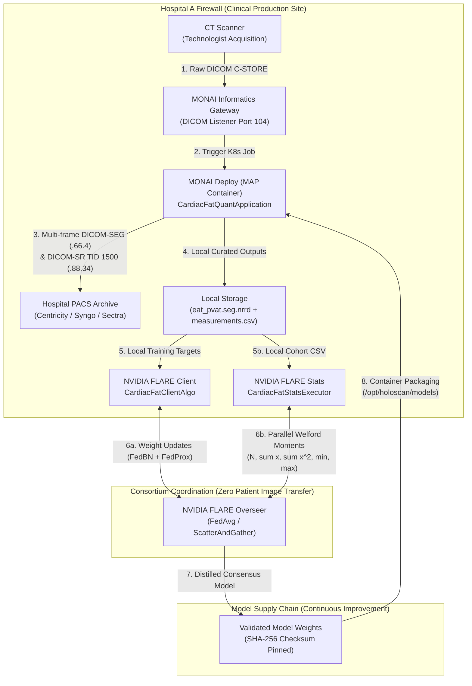
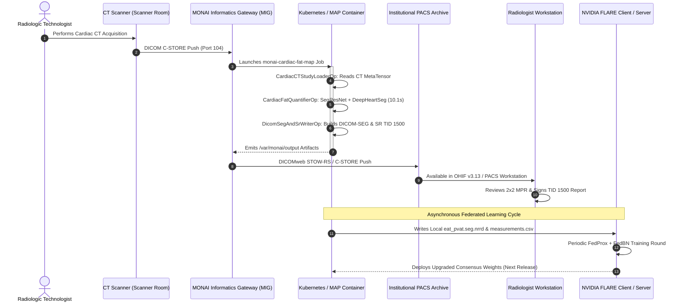

# Closed-Loop Federated Clinical Architecture: MONAI Deploy & NVIDIA FLARE

This document details the architectural interplay, data contracts, and continuous learning lifecycle ("AI Flywheel") connecting the **MONAI Deploy Application Package (MAP)** and the **NVIDIA FLARE 2.5+** federated learning and analytics system in `monai-cardiac-fat-fl`.

---

## 1. Executive Summary & Dual-Engine Architecture

In institutional healthcare AI, clinical inference and collaborative learning are often treated as disconnected silos. `monai-cardiac-fat-fl` bridges them into a **closed-loop clinical AI flywheel**:

| Architecture Layer | Core Component | Role & Scope | Runtime Cadence | Security & Boundary |
| :--- | :--- | :--- | :--- | :--- |
| **Frontline Clinical Edge** | **MONAI Deploy (MAP)** | Real-time automated CT ingestion, 3D anatomy segmentation, and PACS archive transmission. | Real-time per scan ($\sim 10.1\,\text{s}$ on RTX 4090). | Operates entirely inside hospital intranet; outputs DICOM-SEG (`.66.4`) and DICOM-SR TID 1500 (`.88.34`). |
| **Consortium Coordination** | **NVIDIA FLARE 2.5+** | Privacy-preserving model distillation (FedProx + FedBN) and cohort moment aggregation (Welford). | Scheduled federated rounds across institutions. | **Zero DICOM transfer**; only encrypted model weights and scalar statistical moments cross firewalls. |



---

## 2. The Three Closed-Loop Integration Pathways

### Pathway 1: Model Supply Chain (NVIDIA FLARE $\rightarrow$ MONAI Deploy)

1. **Multi-Center Federated Distillation**:
   - Participating hospitals collaborate via NVIDIA FLARE using `CardiacFatClientAlgo` ([`src/cardiac_fat_fl/fl_client_algo.py`](../src/cardiac_fat_fl/fl_client_algo.py)).
   - **FedBN Invariant**: Batch normalization layers remain local to each hospital to absorb site-specific scanner biases (Siemens vs. GE vs. Philips kernels), while convolutional and linear weights are aggregated globally.
   - **FedProx Regularization**: A proximal loss term ($\mu > 0$) prevents local client drift on heterogeneous patient populations.
2. **Consensus Model Checkpointing**:
   - The central FLARE aggregator converges on a validated global 3D SegResNet checkpoint (`best_model.pt`).
3. **Packaging into MONAI Application Package (MAP)**:
   - The validated model weights are cryptographically verified against official SHA-256 digests in [`models/checksums.sha256`](../models/checksums.sha256).
   - Weights are baked into the immutable container under `/opt/holoscan/models/` ([`monai_deploy_roadmap/app.yaml`](../monai_deploy_roadmap/app.yaml)).
4. **Clinical Deployment**:
   - The updated MAP image (`ghcr.io/tylerp61391/monai-cardiac-fat-map:1.0.0`) is pushed to institutional container registries and updated across hospital Kubernetes clusters with zero application code changes.

---

### Pathway 2: Automated Data Curation & Pre-Annotation (MONAI Deploy $\rightarrow$ NVIDIA FLARE)

1. **Daily Clinical Processing**:
   - As patients receive routine cardiac or chest CT scans, MONAI Deploy’s `CardiacFatQuantifierOp` and `DicomSegAndSrWriterOp` process the studies in $\sim 10\,\text{s}$.
2. **Automated Ground Truth Generation**:
   - In addition to sending clinical DICOM-SEG and DICOM-SR to PACS, MONAI Deploy saves:
     - `eat_pvat.seg.nrrd` (standard 8-compartment volume mask).
     - `cardiac_fat_measurements.csv` (19-column quantitative metrics).
3. **Local Training Data Ingestion**:
   - When the next federated learning round begins, `discover_participants` scans the local study directory.
   - The 8-compartment segmentation masks generated by the dual-network pipeline immediately serve as **pre-annotated supervision targets** for local client training.
   - **Impact**: Completely eliminates the multi-month bottleneck of manual expert radiologist contouring for ongoing AI model updates.

---

### Pathway 3: Zero-DICOM Population Analytics (MONAI Deploy $\rightarrow$ FLARE Stats)

1. **Standardized Clinical Metrics**:
   - MONAI Deploy produces the canonical 19-column schema ([`measurement_schema.py`](../src/cardiac_fat_fl/measurement_schema.py)) for every patient scanned in the hospital.
2. **Federated Query Trigger**:
   - A multi-center consortium or clinical trial initiates a federated query (e.g., assessing mean PVAT attenuation across 25,000 diabetic patients across 6 health systems).
3. **Local Moment Extraction via `CardiacFatStatsExecutor`**:
   - The local NVFLARE client executes [`fl_stats_executor.py`](../src/cardiac_fat_fl/fl_stats_executor.py) on the local `cardiac_fat_measurements.csv`.
   - It extracts scalar moments for each of the 9 anatomical regions:
     $$M_k = \left(N_k, \sum x, \sum x^2, \min(x), \max(x)\right)$$
4. **Exact Welford Synthesis**:
   - The central FLARE aggregator executes `aggregate_site_moments`, combining scalar summaries into exact pooled population statistics ($p < 10^{-15}$ precision) without a single patient record or image ever crossing hospital firewalls.

---

## 3. End-to-End Clinical Sequence Diagram



---

## 4. Hospital DevOps & Infrastructure Deployment

### A. Standalone CLI & Development Mode

```bash
# Execute the MONAI Deploy 3-operator DAG directly on an existing CT study:
cardiac-fat-fl map-run -i "example_source_dir/0506" -o "scratch/map_output"
```

### B. Single-Command Turnkey Clinical Testbed (Docker Compose)

Spin up an enterprise PACS ([Orthanc](https://www.orthanc-server.com/)), the MONAI Deploy Informatics Gateway (MIG), and the MAP container worker:

```bash
docker compose -f monai_deploy_roadmap/docker-compose.monai-deploy.yml up -d
```

- **Orthanc PACS Web UI**: `http://localhost:8042` (DICOMweb REST API)
- **DICOM DIMSE Port**: `localhost:4242` (AET: `ORTHANC`)
- **MONAI Informatics Gateway SCP**: `localhost:11112` (AET: `MONAIMIG`)

### C. Enterprise Kubernetes Batch Job (Production Clinical Deployment)

```yaml
apiVersion: batch/v1
kind: Job
metadata:
  name: cardiac-fat-quant-job
  namespace: clinical-ai
spec:
  template:
    spec:
      restartPolicy: OnFailure
      containers:
      - name: cardiac-fat-map
        image: ghcr.io/tylerp61391/monai-cardiac-fat-map:1.0.0
        resources:
          limits:
            nvidia.com/gpu: 1
            memory: 16Gi
            cpu: "4"
        volumeMounts:
        - name: dicom-incoming
          mountPath: /var/monai/input
          readOnly: true
        - name: dicom-outgoing
          mountPath: /var/monai/output
      volumes:
      - name: dicom-incoming
        persistentVolumeClaim:
          claimName: pvc-mig-incoming
      - name: dicom-outgoing
        persistentVolumeClaim:
          claimName: pvc-mig-outgoing
```

---

## 5. Security, Privacy & Regulatory Traceability

1. **HIPAA & GDPR Physical Data Isolation**:
   - Patient Health Information (PHI) and raw high-resolution CT volumes remain strictly locked inside institutional boundaries.
   - The NVIDIA FLARE communication channel is TLS-encrypted and restricted to numeric parameter vectors.
2. **Cryptographic Model Verification**:
   - Model weights mounted at runtime (`/opt/holoscan/models/`) are verified against pinned SHA-256 digests in memory before execution, preventing supply-chain poisoning.
3. **FDA SaMD Design History**:
   - Conforms to IEC 62304 software safety standards and ISO 14971 medical device risk management documented in [`docs/regulatory/FDA_SAMD_REGULATORY_DOSSIER.md`](regulatory/FDA_SAMD_REGULATORY_DOSSIER.md).

