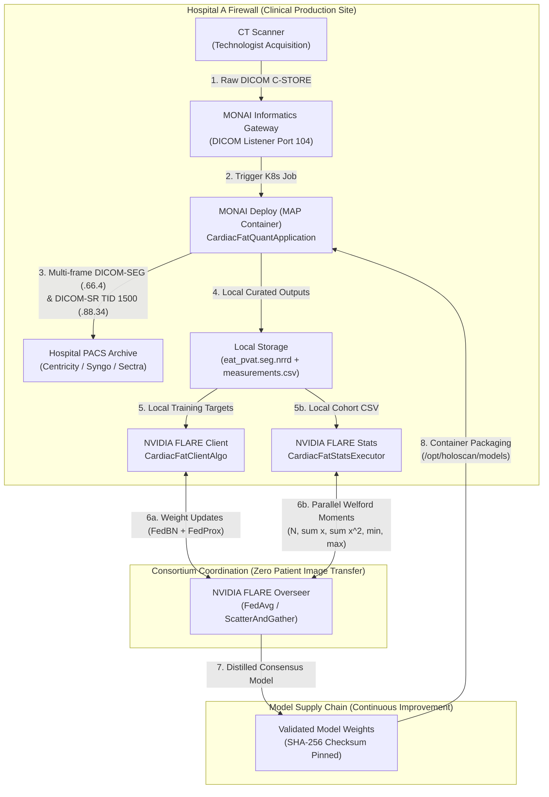
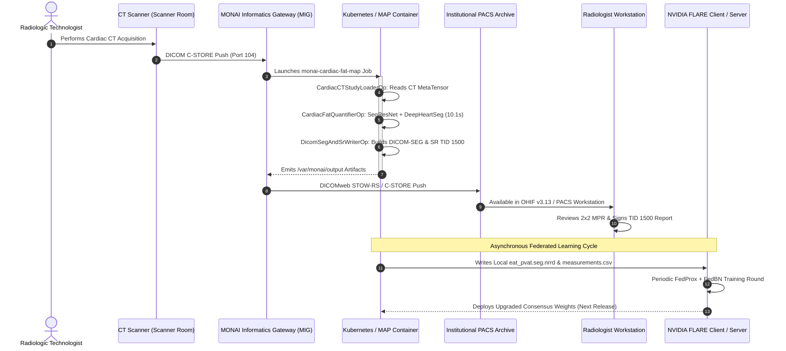

# Closed-Loop Federated Clinical Architecture: MONAI Deploy & NVIDIA FLARE

This document details the architectural interplay, data contracts, and continuous learning lifecycle ("AI Flywheel") connecting the **MONAI Deploy Application Package (MAP)** and the **NVIDIA FLARE 2.5+** federated learning and analytics system in `monai-cardiac-fat-fl`.

---

## 1. Executive Summary & Dual-Engine Architecture

In institutional healthcare AI, clinical inference and collaborative learning are often treated as disconnected silos. `monai-cardiac-fat-fl` bridges them into a **closed-loop clinical AI flywheel**:

| Architecture Layer | Core Component | Role & Scope | Runtime Cadence | Security & Boundary |
| :--- | :--- | :--- | :--- | :--- |
| **Frontline Clinical Edge** | **MONAI Deploy (MAP)** | Real-time automated CT ingestion, 3D anatomy segmentation, and PACS archive transmission. | Real-time per scan ($\sim 10.1\,\text{s}$ on RTX 4090). | Operates entirely inside hospital intranet; outputs DICOM-SEG (`.66.4`) and DICOM-SR TID 1500 (`.88.34`). |
| **Consortium Coordination** | **NVIDIA FLARE 2.5+** | Privacy-preserving model distillation (FedProx + FedBN) and cohort moment aggregation (Welford). | Scheduled federated rounds across institutions. | **Zero DICOM transfer**; only encrypted model weights and scalar statistical moments cross firewalls. |



---

## 2. The Three Closed-Loop Integration Pathways

### Pathway 1: Model Supply Chain (NVIDIA FLARE $\rightarrow$ MONAI Deploy)

1. **Multi-Center Federated Distillation**:
   - Participating hospitals collaborate via NVIDIA FLARE using `CardiacFatClientAlgo` ([`src/cardiac_fat_fl/fl_client_algo.py`](../src/cardiac_fat_fl/fl_client_algo.py)).
   - **FedBN Invariant**: Batch normalization layers remain local to each hospital to absorb site-specific scanner biases (Siemens vs. GE vs. Philips kernels), while convolutional and linear weights are aggregated globally.
   - **FedProx Regularization**: A proximal loss term ($\mu > 0$) prevents local client drift on heterogeneous patient populations.
2. **Consensus Model Checkpointing**:
   - The central FLARE aggregator converges on a validated global 3D SegResNet checkpoint (`best_model.pt`).
3. **Packaging into MONAI Application Package (MAP)**:
   - The validated model weights are cryptographically verified against official SHA-256 digests in [`models/checksums.sha256`](../models/checksums.sha256).
   - Weights are baked into the immutable container under `/opt/holoscan/models/` ([`deploy/app.yaml`](../deploy/app.yaml)).
4. **Clinical Deployment**:
   - The updated MAP image (`ghcr.io/tylerp61391/monai-cardiac-fat-map:1.0.0`) is pushed to institutional container registries and updated across hospital Kubernetes clusters with zero application code changes.

---

### Pathway 2: Automated Data Curation & Pre-Annotation (MONAI Deploy $\rightarrow$ NVIDIA FLARE)

1. **Daily Clinical Processing**:
   - As patients receive routine cardiac or chest CT scans, MONAI Deploy’s `CardiacFatQuantifierOp` and `DicomSegAndSrWriterOp` process the studies in $\sim 10\,\text{s}$.
2. **Automated Ground Truth Generation**:
   - In addition to sending clinical DICOM-SEG and DICOM-SR to PACS, MONAI Deploy saves:
     - `eat_pvat.seg.nrrd` (standard 8-compartment volume mask).
     - `cardiac_fat_measurements.csv` (19-column quantitative metrics).
3. **Local Training Data Ingestion**:
   - When the next federated learning round begins, `discover_participants` scans the local study directory.
   - The 8-compartment segmentation masks generated by the dual-network pipeline immediately serve as **pre-annotated supervision targets** for local client training.
   - **Impact**: Completely eliminates the multi-month bottleneck of manual expert radiologist contouring for ongoing AI model updates.

---

### Pathway 3: Zero-DICOM Population Analytics (MONAI Deploy $\rightarrow$ FLARE Stats)

1. **Standardized Clinical Metrics**:
   - MONAI Deploy produces the canonical 19-column schema ([`measurement_schema.py`](../src/cardiac_fat_fl/measurement_schema.py)) for every patient scanned in the hospital.
2. **Federated Query Trigger**:
   - A multi-center consortium or clinical trial initiates a federated query (e.g., assessing mean PVAT attenuation across 25,000 diabetic patients across 6 health systems).
3. **Local Moment Extraction via `CardiacFatStatsExecutor`**:
   - The local NVFLARE client executes [`fl_stats_executor.py`](../src/cardiac_fat_fl/fl_stats_executor.py) on the local `cardiac_fat_measurements.csv`.
   - It extracts scalar moments for each of the 9 anatomical regions:
     $$M_k = \left(N_k, \sum x, \sum x^2, \min(x), \max(x)\right)$$
4. **Exact Welford Synthesis**:
   - The central FLARE aggregator executes `aggregate_site_moments`, combining scalar summaries into exact pooled population statistics ($p < 10^{-15}$ precision) without a single patient record or image ever crossing hospital firewalls.

---

## 3. End-to-End Clinical Sequence Diagram



---

## 4. MONAI Deploy Application Package (MAP) Architecture & DevOps

### A. 3-Node Operator Directed Acyclic Graph (DAG)

The MAP application (`CardiacFatQuantApplication` in [`src/cardiac_fat_fl/monai_deploy.py`](../src/cardiac_fat_fl/monai_deploy.py)) structures inference and clinical export as a modular 3-operator DAG:

| MONAI Deploy Operator | Underlying Module | Input Port (`op_input`) | Output Port (`op_output`) | Clinical Function |
| :--- | :--- | :--- | :--- | :--- |
| **`CardiacCTStudyLoaderOp`** | [`io_metatensor.py`](../src/cardiac_fat_fl/io_metatensor.py) | `input_path` (`/var/monai/input`) | `ct_metatensor` (`MetaTensor`), `source_dcm_dir` (`Path`) | Ingests clinical axial DICOM series, NRRD, or NIfTI; natural sorting; resolves multi-series scout collisions via max-slice detection. |
| **`CardiacFatQuantifierOp`** | [`anatomy_segmenter.py`](../src/cardiac_fat_fl/anatomy_segmenter.py), [`transforms.py`](../src/cardiac_fat_fl/transforms.py) | `ct_metatensor` (`MetaTensor`) | `seg_mask_8ch` (`np.ndarray`), `anatomy_masks` (`AnatomyMasks`), `metrics` (`dict`) | Executes dual-network segmentation (WholeBody 1.5mm SegResNet + DeepHeartSeg ONNX pericardium + coronary sulci), Voronoi chamber allocation, 10mm anisotropic EDT vessel dilation, and $[-190.0, -30.0] HU$ fat attenuation math. |
| **`DicomSegAndSrWriterOp`** | [`ohif_exporter.py`](../src/cardiac_fat_fl/ohif_exporter.py), [`dicom_sr.py`](../src/cardiac_fat_fl/dicom_sr.py) | `seg_mask_8ch`, `metrics`, `source_dcm_dir`, `output_path` (`/var/monai/output`) | Writes artifacts to `/var/monai/output` | Packages multi-frame DICOM-SEG (`1.2.840.10008.5.1.4.1.1.66.4`), Comprehensive 3D DICOM-SR TID 1500 (`1.2.840.10008.5.1.4.1.1.88.34`), 8-channel NRRD (`eat_pvat.seg.nrrd`), and 19-column CSV metrics. |

### B. MAP Container Layout & Hardware Resource Contracts

Conforming to the **MONAI Application Package (MAP)** specification and NVIDIA Holoscan SDK contracts, the container declares explicit directory mount points and hardware envelopes in [`deploy/app.yaml`](../deploy/app.yaml):

- **Directory Mounts**:
  - `/var/monai/input`: Read-only clinical DICOM CT study directory mounted by MONAI Workflow Manager or Kubernetes PVC.
  - `/var/monai/output`: Writable directory receiving `eat_pvat_seg.dcm`, `eat_pvat_sr.dcm`, and `cardiac_fat_measurements.csv`.
  - `/opt/holoscan/models`: Model directory containing SHA-256 verified weights (`wholeBody_ct_segmentation/models/model.pt`, `deepheartseg_loc.onnx`, `deepheartseg_heart.onnx`).
- **Hardware Envelopes**:
  - `cpu`: `4` cores
  - `memory`: `16Gi` system RAM
  - `gpu`: `1` NVIDIA GPU (≥ 8 GB VRAM; runtime footprint $pprox 2.5\text{ GB}$)
  - `gpuMemory`: `8Gi`
- **Container Artifacts**:
  - [`deploy/Dockerfile`](../deploy/Dockerfile): Production OCI container image build recipe.
  - [`deploy/app.py`](../deploy/app.py): Application entrypoint executing the 3-operator pipeline.
  - [`deploy/app.yaml`](../deploy/app.yaml): Declarative MAP manifest validated by `tests/test_monai_deploy.py`.

### C. Standalone CLI & Development Mode

```bash
# Execute the MONAI Deploy 3-operator DAG directly on an existing CT study:
cardiac-fat-fl map-run -i "example_source_dir/0506" -o "scratch/map_output"
```

### D. Single-Command Turnkey Clinical Testbed (Docker Compose)

Spin up an enterprise PACS ([Orthanc](https://www.orthanc-server.com/)), the MONAI Deploy Informatics Gateway (MIG), and the MAP container worker:

```bash
docker compose -f deploy/docker-compose.monai-deploy.yml up -d
```

- **Orthanc PACS Web UI**: `http://localhost:8042` (DICOMweb REST API)
- **DICOM DIMSE Port**: `localhost:4242` (AET: `ORTHANC`)
- **MONAI Informatics Gateway SCP**: `localhost:11112` (AET: `MONAIMIG`)

### E. Enterprise Kubernetes Batch Job (Production Clinical Deployment)

```yaml
apiVersion: batch/v1
kind: Job
metadata:
  name: cardiac-fat-quant-job
  namespace: clinical-ai
spec:
  template:
    spec:
      restartPolicy: OnFailure
      containers:
      - name: cardiac-fat-map
        image: ghcr.io/tylerp61391/monai-cardiac-fat-map:1.0.0
        resources:
          limits:
            nvidia.com/gpu: 1
            memory: 16Gi
            cpu: "4"
        volumeMounts:
        - name: dicom-incoming
          mountPath: /var/monai/input
          readOnly: true
        - name: dicom-outgoing
          mountPath: /var/monai/output
      volumes:
      - name: dicom-incoming
        persistentVolumeClaim:
          claimName: pvc-mig-incoming
      - name: dicom-outgoing
        persistentVolumeClaim:
          claimName: pvc-mig-outgoing
```

---

## 5. Turnkey SOTA NVIDIA FLARE 2.5+ Simulator & Multi-Hospital Execution

To validate multi-center continuous learning without requiring physical multi-hospital cluster infrastructure, the framework includes a turnkey NVIDIA FLARE simulation engine and production-ready job package (`jobs/cardiac_fat_fl/`):

### A. Turnkey Simulation CLI Command

```bash
# Execute 2-client federated distillation across 2 rounds with consensus checkpointing
cardiac-fat-fl federated-simulate --n-clients 2 --threads 2 --rounds 2
```

- `--job-dir`: Path to the job folder (default: `jobs/cardiac_fat_fl`).
- `--n-clients`: Number of simulated hospital client sites (default: 2).
- `--threads`: Number of concurrent simulator client execution threads.
- `--rounds`: Dynamic aggregation round count override.
- `--workspace`: Workspace directory for logs, metrics, and consensus checkpoints.
- `--gpu`: Optional comma-separated GPU device IDs (e.g. `0` or `0,1`) or CPU mode.

### B. Standard Job Package Layout (`jobs/cardiac_fat_fl/`)

```text
jobs/cardiac_fat_fl/
├── meta.json                         # Job metadata (min_clients: 2, byoc: true, deploy_map: @ALL)
└── app/
    └── config/
        ├── config_fed_server.json    # Server workflows: ScatterAndGather, Persistor, Aggregator, ModelLocator
        └── config_fed_client.json    # Client executors: CardiacFatTrainer, CardiacFatStatsExecutor
```

### C. Client Execution Engine (`CardiacFatTrainer`)

The `CardiacFatTrainer(Executor)` in [`fl_client_algo.py`](../src/cardiac_fat_fl/fl_client_algo.py) connects NVFLARE’s task execution lifecycle directly to MONAI:

- **`train`**: Deserializes global weights from DXO (`DataKind.WEIGHTS`), executes local training with FedProx proximal loss ($\mu = 0.01$), retains local FedBN normalization layers (`BatchNorm3d`, `InstanceNorm3d`), and packages updated convolutional/linear weights back into a DXO.
- **`validate`**: Evaluates local holdout CT volumes against incoming global weights, computing quantitative validation Dice and Loss (`DataKind.METRICS`).
- **`submit_model`**: Extracts local site model checkpoints for central evaluation.

### D. Server Orchestration & Cross-Site Evaluation

- **`ScatterAndGather` Workflow**: Coordinates round-by-round weight distribution and collection.
- **`PTFileModelPersistor`**: Checkpoints global consensus model weights (`SRV_FL_global_model.pt`).
- **`AccumulateWeightedAggregator`**: Aggregates site parameter updates.
- **`IntimeModelSelector`**: Selects best checkpoint based on `val_dice`.
- **`PTFileModelLocator` & `CrossSiteModelEval`**: Coordinates automated post-training cross-site validation of the consensus model across all client datasets.

### E. Enterprise OS Resilience & Windows Self-Healing

The [`federated_simulator.py`](../src/cardiac_fat_fl/federated_simulator.py) module includes `ensure_nvflare_windows_compatibility()` to patch platform-specific hurdles on Windows:

1. **NTFS Directory Locks**: Patches `SimulatorRunner._cleanup_workspace()` to clean contents rather than attempting to delete the process's own working directory (`PermissionError: [WinError 32]`).
2. **POSIX `setsid` Incompatibility**: Replaces Linux-specific `os.setsid` in subprocess creation with `CREATE_NEW_PROCESS_GROUP` while preserving Windows backslash path semantics.
3. **Safe Storage Deletion**: Enforces `ignore_errors=True` in `SimulatorDeployer.close()`.

### F. Interactive Research Dashboard: Federated Learning Control & Monitoring Panel

The interactive Research Dashboard (`cardiac-fat-fl dashboard --port 8050`) provides a zero-code web interface for launching and monitoring federated simulations in real-time under `#tab-federated`:

- **Job Configuration & Hyperparameters**: Customize participating hospital count ($N$), aggregation rounds ($R$), worker concurrency, FedProx $\mu$, and FedBN local normalization retention.
- **Round-by-Round Convergence Graph**: Real-time Chart.js visualization plotting global validation DICE ($\text{val\_dice} \in [0, 1.0]$) and cross-entropy loss over aggregation rounds.
- **Participating Hospital Site Scorecards**: Visual cards for each simulated hospital site (`site-1`, `site-2`, ...) tracking local status (`ready`, `training`, `validating`), current MONAI SegResNet activity, FedBN status, and latest site DICE score.
- **Model Checkpoints & 1-Click Weights Download**: Table listing all consensus checkpoints (`FL_global_model.pt`, etc.) with file sizes and timestamps, backed by `GET /api/federated/download/<filename>`.
- **Live Monospace Audit & Execution Console**: Auto-scrolling terminal window displaying real-time NVFLARE scatter/gather lifecycle events and client training logs.

#### REST API Endpoints

| Method | Endpoint | Description |
| :--- | :--- | :--- |
| `GET` | `/api/federated/status` | Returns live simulation status, current round, progress %, client site states, metrics, and console logs. |
| `POST` | `/api/federated/run` | Triggers background simulation thread with user hyperparameters (`n_clients`, `num_rounds`, `threads`, `fedprox_mu`, `fed_bn`). |
| `POST` | `/api/federated/reset` | Resets simulation state and clears convergence metrics and console buffer. |
| `GET` | `/api/federated/models` | Scans `models/federated/` and returns available consensus checkpoint metadata. |
| `GET` | `/api/federated/download/<filename>` | Secure download endpoint serving PyTorch `.pt` model checkpoint binaries. |

---

## 6. Security, Privacy & Regulatory Traceability

1. **HIPAA & GDPR Physical Data Isolation**:
   - Patient Health Information (PHI) and raw high-resolution CT volumes remain strictly locked inside institutional boundaries.
   - The NVIDIA FLARE communication channel is TLS-encrypted and restricted to numeric parameter vectors.
2. **Cryptographic Model Verification**:
   - Model weights mounted at runtime (`/opt/holoscan/models/`) are verified against pinned SHA-256 digests in memory before execution, preventing supply-chain poisoning.
3. **FDA SaMD Design History**:
   - Conforms to IEC 62304 software safety standards and ISO 14971 medical device risk management documented in [`docs/regulatory/FDA_SAMD_REGULATORY_DOSSIER.md`](regulatory/FDA_SAMD_REGULATORY_DOSSIER.md).
