# Architecture Review: System Specification & Execution Flow

This visual walkthrough documents the internal architecture, mathematical invariants, deep learning models, and clinical interoperability pipeline of `monai-cardiac-fat-fl`.

- **Companion Interactive Blueprint**: [`docs/architecture_infographic.html`](../architecture_infographic.html)
- **Comprehensive Text Specification**: [`docs/ARCHITECTURE_CODE_REVIEW.md`](../ARCHITECTURE_CODE_REVIEW.md)
- **High-Resolution Slide Deck PDF**: [`docs/Cardiac_Segmentation_Architecture.pdf`](../Cardiac_Segmentation_Architecture.pdf)
- **Full Slide Presentation**: [`docs/presentation_deck.html`](../presentation_deck.html)

---

## Slide 1: System Architecture & In-Memory GPU Execution Summary

Overview of the unified pipeline translating raw 3D cardiac CT scans into calibrated 8-compartment fat segmentations, standard DICOM-SEG, and DICOM-SR TID 1500 reports.

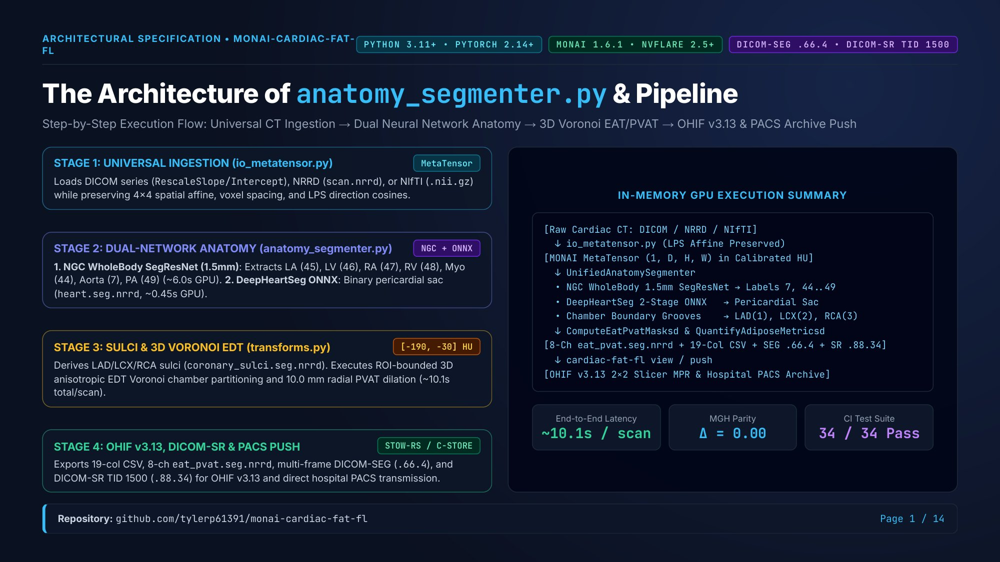

- **Source Modules**: [`io_metatensor.py`](../../src/cardiac_fat_fl/io_metatensor.py), [`anatomy_segmenter.py`](../../src/cardiac_fat_fl/anatomy_segmenter.py), [`transforms.py`](../../src/cardiac_fat_fl/transforms.py)
- **Performance**: $\sim 10.1\,\text{s}$ / scan on NVIDIA RTX 4090 ($15\times$ speedup vs. foundational CPU pipeline).
- **Parity**: $\Delta = 0.00\,\text{cm}^3, \Delta = 0.00\,\text{HU}$ ($r = 1.000$) on reference cohorts; 34/34 automated tests passing.

---

## Slide 2: Modernization Benchmark (Foundational MGH vs. Modern Pipeline)

Direct dimensional comparison between the multi-script Harvard/MGH `CardiacFatQuant` pipeline and this modernized MONAI/FLARE system.

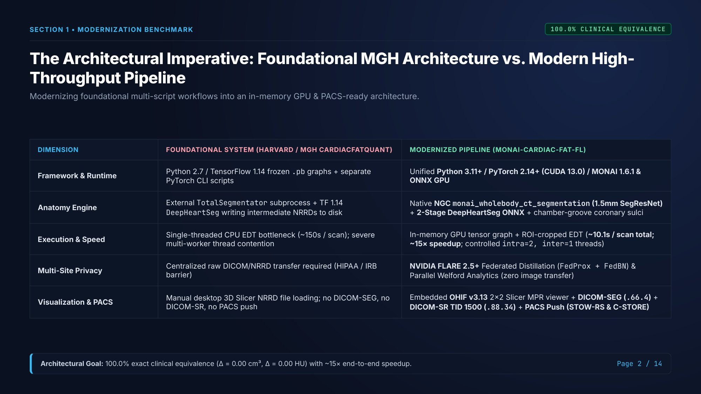

- **Eliminates Intermediate Disk Serialization**: Multi-stage processing occurs entirely in GPU memory as PyTorch `MetaTensor` objects.
- **Controlled Concurrency**: Explicit ONNX thread allocation (`intra_op_num_threads = 2`, `inter_op_num_threads = 1`) eliminates multi-worker CPU contention.

---

## Slide 3: 5-Stage High-Level Tensor Lifecycle

The computational journey of a CT scan from DICOM acquisition to PACS archive transmission.

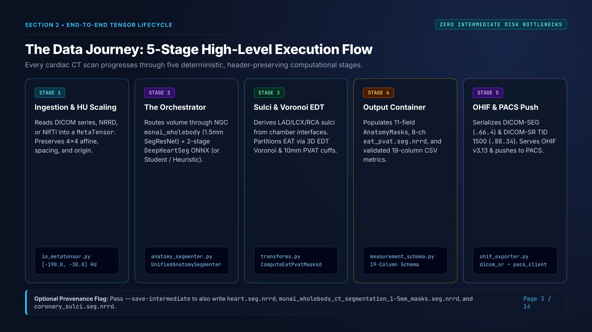

- **Stage 1**: Universal ingestion and radiodensity calibration (`io_metatensor.py`).
- **Stage 2**: Dual-network anatomy orchestration (`anatomy_segmenter.py`).
- **Stage 3**: Sulci derivation and 3D anisotropic Voronoi partitioning (`transforms.py`).
- **Stage 4**: Standardized measurement container marshalling (`measurement_schema.py`).
- **Stage 5**: OHIF v3.13 workstation generation and direct PACS push (`ohif_exporter.py`, `pacs_client.py`).

---

## Slide 4: Step 1: Universal Ingestion & Hounsfield Unit Normalization

Preserving physical CT radiodensity and anisotropic voxel geometry across multi-vendor scanners.

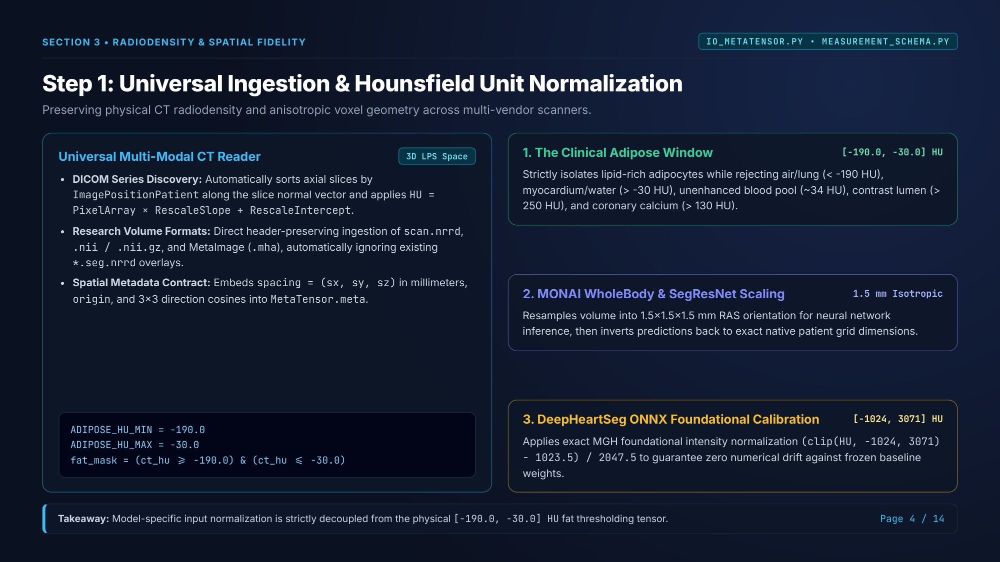

- **Clinical Adipose Window**: Strictly $[-190.0, -30.0]\,\text{HU}$ (`ADIPOSE_HU_MIN = -190.0`, `ADIPOSE_HU_MAX = -30.0`).
- **Affine Tracking**: Retains $4 \times 4$ spatial affine, voxel spacing $(s_x, s_y, s_z)$, and LPS direction cosines.
- **Foundational Calibration**: DeepHeartSeg intensity scaling maps $[-1024, 3071]\,\text{HU}$ with zero numerical drift.

---

## Slide 5: Step 2: The Orchestrator & Dual-Network Synergy

Combining the complementary strengths of NVIDIA NGC SegResNet and DeepHeartSeg ONNX.

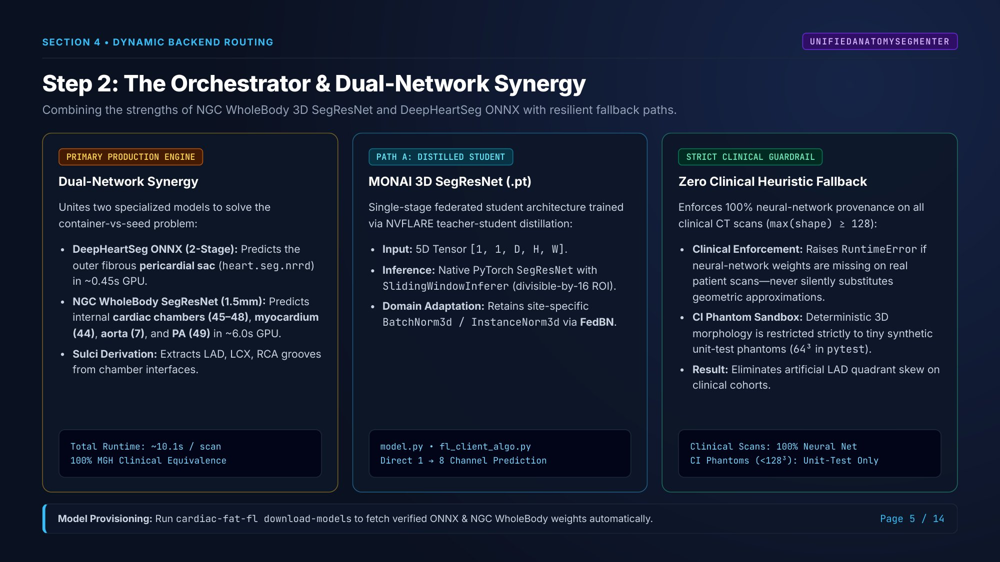

- **Container-vs-Seed Problem**: Solved by pairing DeepHeartSeg ONNX (outer pericardial boundary) with NGC WholeBody SegResNet (internal cardiac chambers and great vessels).
- **Strict Clinical Guardrail**: Clinical CT scans ($\max(D, H, W) \ge 128$) mandate neural-network weights; heuristic fallback is strictly barred.

---

## Slide 6: Primary Engine A: `monai_wholebody_ct_segmentation`

High-resolution 1.5 mm isotropic 3D SegResNet predicting 104 anatomical structures.

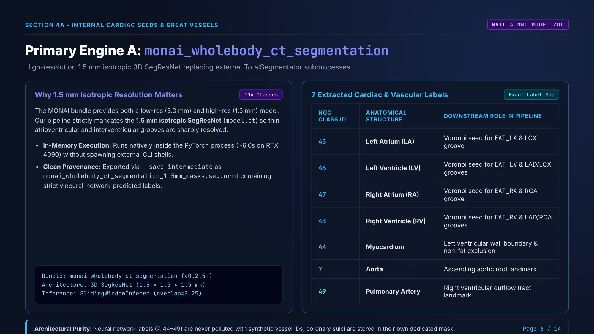

- **7 Extracted Structures**: Left Atrium (`45`), Left Ventricle (`46`), Right Atrium (`47`), Right Ventricle (`48`), Myocardium (`44`), Aorta (`7`), Pulmonary Artery (`49`).
- **Execution**: Native in-memory PyTorch sliding-window inference ($\sim 6.0\,\text{s}$ on RTX 4090).

---

## Slide 7: Primary Engine B: 2-Stage DeepHeartSeg Pericardial Pipeline

Zero-drift ONNX conversion of the Harvard/MGH frozen TensorFlow 1.14 graphs.

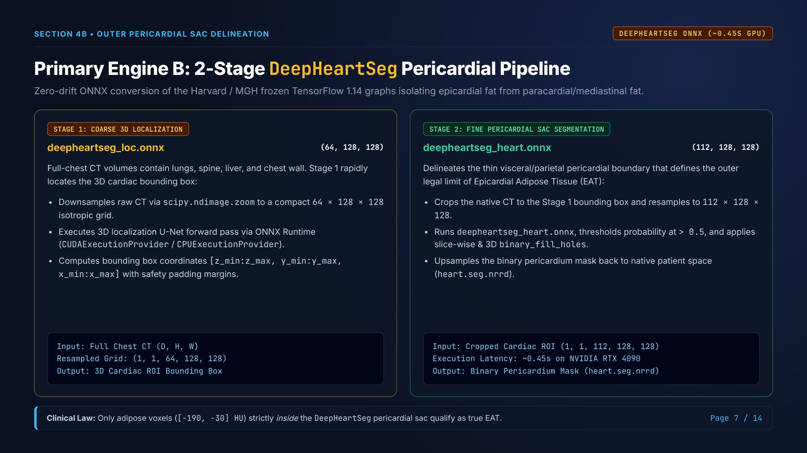

- **Stage 1 (`deepheartseg_loc.onnx`)**: Coarse $64 \times 128 \times 128$ 3D localization of the cardiac bounding box.
- **Stage 2 (`deepheartseg_heart.onnx`)**: High-resolution $112 \times 128 \times 128$ segmentation of the thin fibrous pericardial sac ($\sim 0.45\,\text{s}$ on RTX 4090).

---

## Slide 8: Optimizing Concurrency: Thread Control & Hardware Safety

Eliminating thread contention and host out-of-memory crashes during batch processing.

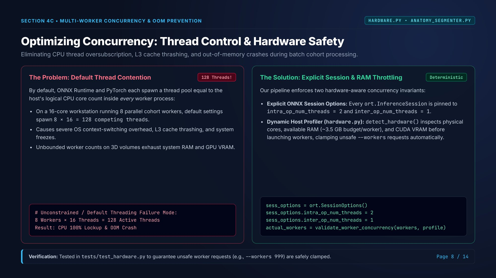

- **Host Resource Profiling**: [`hardware.py`](../../src/cardiac_fat_fl/hardware.py) probes CPU cores, host RAM, and CUDA VRAM.
- **Automatic Concurrency Throttling**: Automatically clamps unsafe `--workers` requests to preserve host OS stability.

---

## Slide 9: Algorithmic Derivation: Coronary Grooves & Chamber Quadrants

Deriving LAD, LCX, and RCA coronary sulci centerlines from chamber boundary interfaces.

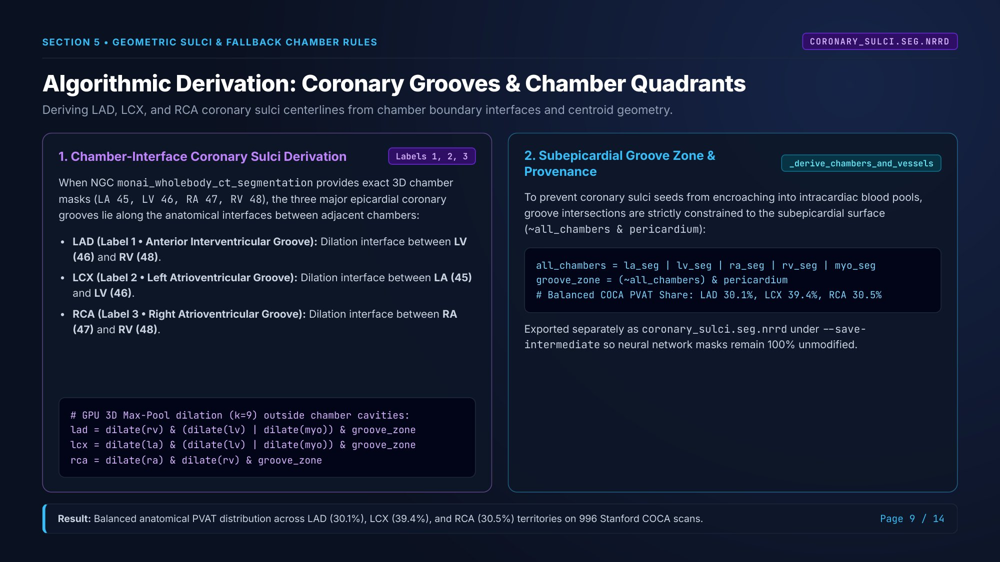

- **Anatomical Grooves**: LAD (anterior interventricular groove, LV-RV interface), LCX (left atrioventricular groove, LA-LV interface), RCA (right atrioventricular groove, RA-RV interface).
- **Subepicardial Boundary**: Sulci seeds strictly restricted to the subepicardial surface $(\sim \text{Chambers} \cap \text{Pericardium})$.

---

## Slide 10: 3D Anisotropic Voronoi Partitioning & 10.0 mm PVAT Dilation

ROI-bounded Euclidean Distance Transforms (EDT) respecting physical millimeter spacing $(s_x, s_y, s_z)$.

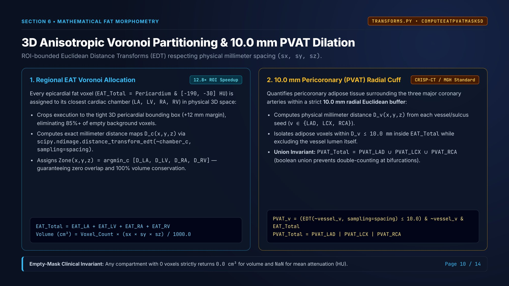

- **ROI Bounding Box**: Distance transform evaluated inside the dilated pericardial envelope (+12 mm margin), yielding a $12.8\times$ speedup.
- **10.0 mm Pericoronary Radial Buffer**: Aligned with the CRISP-CT and foundational MGH standard.
- **Union Invariant**: $\text{PVAT\_Total} = \text{PVAT\_LAD} \cup \text{PVAT\_LCX} \cup \text{PVAT\_RCA}$ (boolean union prevents double-counting).

---

## Slide 11: Step 3: The Unified `AnatomyMasks` Container & 8-Ch Tensor

Type-safe anatomical container marshalling CPU NumPy arrays into GPU PyTorch tensors.

- **8 Output Channels**: Total EAT (`Ch 0`), LA EAT (`Ch 1`), LV EAT (`Ch 2`), RA EAT (`Ch 3`), RV EAT (`Ch 4`), PVAT LAD (`Ch 5`), PVAT LCX (`Ch 6`), PVAT RCA (`Ch 7`).
- **19-Column Schema**: Participant ID + 9 anatomical regions $\times$ 2 metrics (Volume in $\text{cm}^3$, Mean Attenuation in $\text{HU}$).

---

## Slide 12: NVIDIA FLARE 2.5+: Federated Distillation & Welford Analytics

Training unified 3D models and computing exact multi-center population moments with zero patient DICOM transfer.

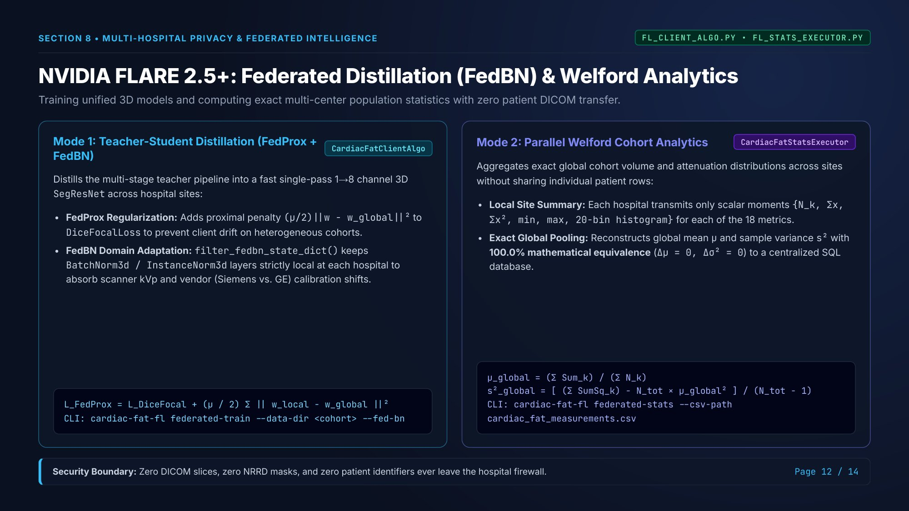

- **Mode 1 (Federated Distillation)**: `ScatterAndGather` with `FedProx` ($\mu > 0$) and `FedBN` (normalization layers remain local).
- **Mode 2 (Parallel Welford Analytics)**: Each site transmits scalar moments $(N_k, \sum x, \sum x^2, \min, \max)$ achieving 100% mathematical equivalence to pooled microdata.

---

## Slide 13: Clinical Benchmarks: Reference Cohort & Stanford AIMI COCA

Validation across the Harvard/MGH reference scans and the full Stanford AIMI COCA multi-vendor cohort ($N = 996$).

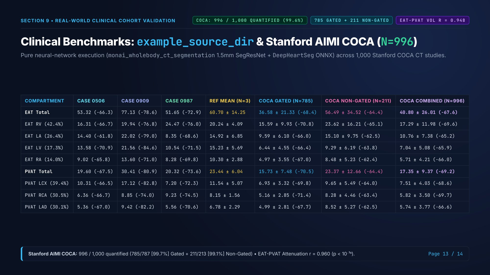

- **Harvard/MGH Benchmark**: Case 0506 ($53.32\,\text{cm}^3$, $-66.3\,\text{HU}$), Case 0909 ($77.13\,\text{cm}^3$, $-78.6\,\text{HU}$), Case 0987 ($51.65\,\text{cm}^3$, $-72.9\,\text{HU}$).
- **Stanford AIMI COCA**: 996/1,000 quantified (785 ECG-gated + 211 non-gated across Siemens, GE, Philips, and Toshiba); EAT-PVAT volume correlation $r = 0.948$ ($p < 10^{-15}$).

---

## Slide 14: Summary: OHIF v3.13 Workstation, DICOM-SR & PACS Archive Push

Seamless translation from automated 3D AI quantification to interactive radiology review and institutional PACS storage.

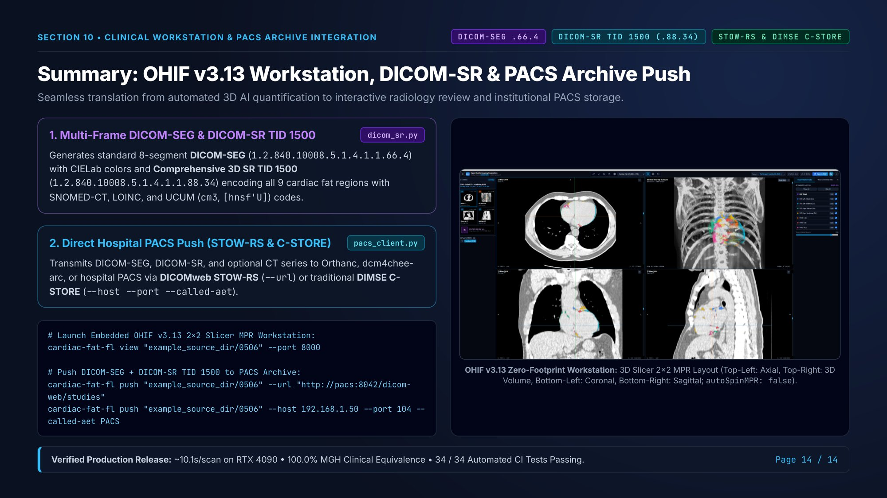

- **DICOM-SEG**: Multi-frame SOP Class `1.2.840.10008.5.1.4.1.1.66.4` with standard CIELab color coding.
- **DICOM-SR**: Comprehensive 3D Structured Report TID 1500 (SOP `1.2.840.10008.5.1.4.1.1.88.34`) with SNOMED-CT, LOINC, and UCUM units.
- **Direct PACS Push**: Dual-protocol support for DICOMweb STOW-RS (with enterprise TLS Root CA bundles) and DIMSE C-STORE.
